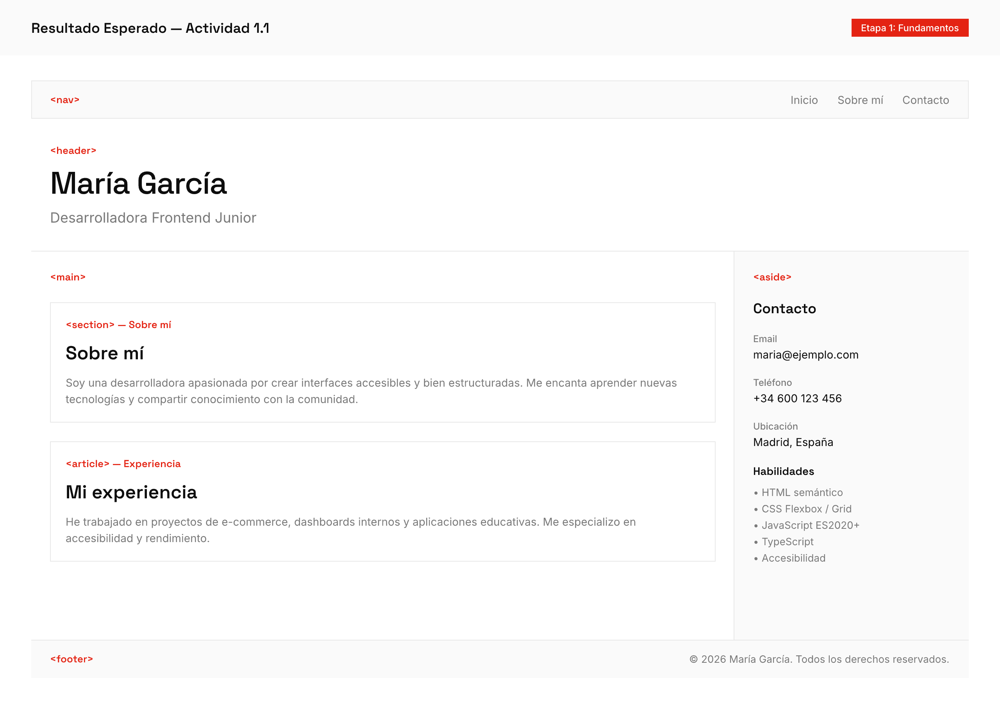
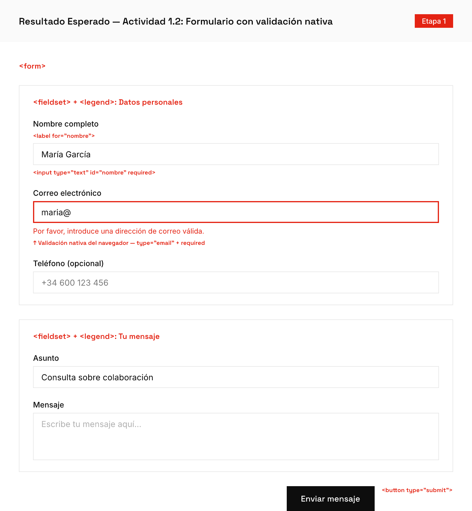
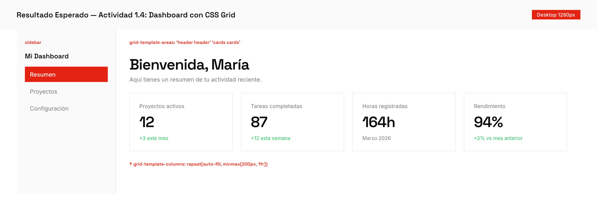

# Etapa 1: Fundamentos

> La plataforma antes del framework. Domina HTML, CSS, JavaScript, TypeScript y accesibilidad antes de tocar cualquier framework.

**Prerrequisitos:** Ninguno. Esta etapa comienza desde cero — la primera actividad te guía para instalar todo lo que necesitas.

---

## Progreso

**Esenciales:** 0/9 | **Recomendadas:** 0/2 | **Avanzadas:** 0/3

---

## Actividades Esenciales

### 🟢 Actividad 1.0 — Preparar tu entorno de desarrollo

- [ ] Completada

**Duración:** ~45 min

**Lectura:**
- [Entorno de Desarrollo](./lecturas/10-entorno-de-desarrollo.md) (~10 min)

#### Antes de empezar

Esta es la primera actividad de todo el programa. Solo necesitas una computadora con acceso a internet. Vamos a instalar las tres herramientas fundamentales: un editor de código, un entorno de ejecución para JavaScript, y un navegador moderno.

#### Práctica paso a paso

**Paso 1 — Instalar un editor de código (VS Code)**

1. Abre tu navegador (Chrome, Firefox, Edge — cualquiera)
2. Ve a [https://code.visualstudio.com](https://code.visualstudio.com)
3. Haz clic en el botón de descarga — el sitio detecta tu sistema operativo automáticamente
4. Ejecuta el instalador. Acepta las opciones por defecto
5. Abre VS Code una vez instalado. Verás la pantalla de bienvenida

**Paso 2 — Instalar Node.js**

Node.js es un programa que permite ejecutar JavaScript fuera del navegador. Muchas herramientas de desarrollo lo necesitan.

1. Ve a [https://nodejs.org](https://nodejs.org)
2. Descarga la versión **LTS** (Long Term Support) — es la más estable
3. Ejecuta el instalador. Acepta las opciones por defecto
4. Para verificar que se instaló correctamente:
   - Abre VS Code
   - Abre la terminal integrada: menú **Terminal → New Terminal** (o presiona `` Ctrl+` `` en Windows/Linux, `` Cmd+` `` en Mac)
   - Escribe `node --version` y presiona Enter. Deberías ver algo como `v20.11.0`
   - Escribe `npm --version` y presiona Enter. Deberías ver algo como `10.2.0`

**Paso 3 — Verificar tu navegador**

Necesitas un navegador moderno con DevTools. Recomendamos **Google Chrome** o **Firefox**.

- Si usas Chrome, ya lo tienes. Si no, descárgalo de [https://www.google.com/chrome](https://www.google.com/chrome)

**Paso 4 — Instalar extensiones recomendadas en VS Code**

Las extensiones agregan funcionalidad a VS Code. Instala estas tres:

1. En VS Code, haz clic en el ícono de cuadraditos en la barra lateral izquierda (o presiona `Ctrl+Shift+X` / `Cmd+Shift+X`)
2. En la barra de búsqueda, escribe **ESLint**. Haz clic en "Install" en la primera opción (autor: Microsoft)
3. Busca **Prettier - Code formatter**. Instálalo
4. Busca **Live Server**. Instálalo (autor: Ritwick Dey) — esta extensión abre tus archivos HTML en el navegador y los actualiza automáticamente cuando guardas

**Paso 5 — Crear tu primer proyecto y configurar linter**

1. Crea una carpeta en tu computadora llamada `etapa-1` (en el Escritorio o donde prefieras)
2. En VS Code: **File → Open Folder** → selecciona la carpeta `etapa-1`
3. Abre la terminal: **Terminal → New Terminal**
4. Ejecuta: `npm init -y` — esto crea un archivo `package.json` que describe tu proyecto
5. Ejecuta: `npm install -D eslint @eslint/js` — esto instala ESLint, la herramienta que detecta errores en tu código
6. Crea un archivo llamado `eslint.config.js` en la raíz de tu carpeta con este contenido:
   ```js
   import js from "@eslint/js";
   export default [
     js.configs.recommended,
     {
       rules: {
         "no-var": "error",
         "no-unused-vars": "warn",
         "no-console": "warn"
       }
     }
   ];
   ```

**Paso 6 — Probar que el linter funciona**

1. Crea un archivo `prueba.js` en tu carpeta con este contenido:
   ```js
   var nombre = "test";
   console.log("hola");
   const sinUsar = 42;
   ```
2. En la terminal, ejecuta: `npx eslint prueba.js`
3. Deberías ver 3 advertencias/errores:
   - `no-var`: no uses `var`, usa `let` o `const`
   - `no-console`: `console.log` está marcado
   - `no-unused-vars`: la variable `sinUsar` nunca se usa
4. Si ves estos errores, tu linter funciona correctamente. Borra `prueba.js`

**Paso 7 — Conocer DevTools del navegador**

1. Abre Chrome (o Firefox)
2. Presiona `F12` (o haz clic derecho en cualquier parte de la página → **Inspect** / **Inspeccionar**)
3. Se abre un panel con varias pestañas. Las más importantes:
   - **Elements** (o **Inspector** en Firefox): muestra el HTML de la página y te permite ver/modificar estilos CSS
   - **Console**: aquí aparecen mensajes de JavaScript y puedes ejecutar código
   - **Network**: muestra todas las peticiones que hace la página (imágenes, datos, etc.)
4. Cierra DevTools presionando `F12` otra vez

#### Validación paso a paso

1. Abre la terminal en VS Code (`` Ctrl+` `` o **Terminal → New Terminal**)
2. Ejecuta: `node --version` — deberías ver un número de versión
3. Ejecuta: `npm --version` — deberías ver un número de versión
4. Crea un archivo `prueba-errores.js` con un `var` adentro
5. Ejecuta: `npx eslint prueba-errores.js` — el linter debería marcar el error
6. Borra el archivo de prueba cuando termines

#### ¿Qué puede salir mal?

- **"npm is not recognized" o "node: command not found"** — Node.js no se instaló correctamente. Ve de nuevo a [nodejs.org](https://nodejs.org), descarga e instala. En Windows, puede que necesites reiniciar VS Code después de instalar
- **"No me aparece la terminal en VS Code"** — Ve al menú **Terminal → New Terminal**. Si no aparece el menú, asegúrate de tener VS Code actualizado
- **"Las extensiones no se instalan"** — Verifica tu conexión a internet. Si estás detrás de un proxy corporativo, consulta con tu equipo de IT

#### Resultado esperado

Al terminar esta actividad, tu computadora tiene todo listo para programar: VS Code con extensiones instaladas, Node.js funcionando en la terminal, y un linter que detecta errores en tu código. Todas las actividades siguientes asumen que esto ya está configurado.


**Criterios de aceptación:**
- [ ] El linter marca `var`, variables no usadas y `console.log`
- [ ] El estudiante inspecciona un elemento en DevTools Elements
- [ ] `npx eslint` pasa con cero warnings en código limpio

---

### 🟢 Actividad 1.1 — Construir un documento HTML con estructura semántica

- [ ] Completada

**Duración:** ~55 min

**Lectura:**
- [HTML Semántico y el DOM](./lecturas/01-html-semantico.md) (~20 min)

#### Antes de empezar

Necesitas tener completada la **Actividad 1.0** (VS Code instalado, Node.js funcionando, extensión Live Server instalada).

Antes de escribir código, entiende qué es un **archivo HTML**: es un archivo de texto plano con extensión `.html` que el navegador interpreta para mostrar una página web. Contiene **etiquetas** (tags) como `<header>`, `<p>`, `<nav>` que le dicen al navegador qué tipo de contenido es cada sección.

Un **editor de texto** como VS Code te permite crear y editar estos archivos. No uses Word ni Google Docs — esos agregan formato invisible que rompe el código. VS Code colorea las etiquetas para que las veas mejor y detecta errores de sintaxis.

#### Práctica paso a paso

**Paso 1 — Crear la carpeta y el archivo**

1. Abre VS Code. Abre la carpeta `etapa-1` que creaste en la Actividad 1.0 (**File → Open Folder**)
2. En el panel izquierdo (Explorer), haz clic derecho → **New Folder** → nómbrala `ejercicio-1.1`
3. Haz clic derecho sobre `ejercicio-1.1` → **New File** → nómbralo `index.html`
4. Se abre el archivo vacío en el editor

**Paso 2 — Escribir la estructura básica (esqueleto HTML)**

1. En el archivo `index.html`, escribe este esqueleto (o cópialo de la lectura):
   ```html
   <!DOCTYPE html>
   <html lang="es">
   <head>
     <meta charset="UTF-8">
     <meta name="viewport" content="width=device-width, initial-scale=1.0">
     <title>Mi Perfil</title>
   </head>
   <body>

   </body>
   </html>
   ```
2. Guarda el archivo: `Ctrl+S` (Windows/Linux) o `Cmd+S` (Mac)

**Paso 3 — Agregar un `<header>` con tu nombre y rol**

Dentro del `<body>`, agrega:
```html
<header>
  <h1>Tu Nombre</h1>
  <p>Frontend Developer en formación</p>
</header>
```

**Paso 4 — Agregar un `<nav>` con 3 enlaces**

Debajo del `<header>`, agrega:
```html
<nav>
  <ul>
    <li><a href="#sobre-mi">Sobre mí</a></li>
    <li><a href="#proyectos">Proyectos</a></li>
    <li><a href="#contacto">Contacto</a></li>
  </ul>
</nav>
```

**Paso 5 — Agregar el contenido principal con `<main>`**

```html
<main>
  <section id="sobre-mi">
    <h2>Sobre mí</h2>
    <p>Escribe un par de párrafos sobre ti, tus intereses en tecnología, por qué quieres ser developer.</p>
  </section>

  <section id="proyectos">
    <h2>Proyectos</h2>
    <article>
      <h3>Proyecto de ejemplo</h3>
      <p>Descripción del proyecto. Qué tecnologías usaste, qué aprendiste.</p>
    </article>
  </section>
</main>
```

**Paso 6 — Agregar una barra lateral con `<aside>`**

Después del `</main>`, agrega:
```html
<aside>
  <h2>Links útiles</h2>
  <ul>
    <li><a href="https://developer.mozilla.org">MDN Web Docs</a></li>
    <li><a href="https://web.dev">web.dev</a></li>
  </ul>
</aside>
```

**Paso 7 — Agregar un `<footer>`**

```html
<footer>
  <p>&copy; 2026 Tu Nombre. Todos los derechos reservados.</p>
</footer>
```

**Paso 8 — Abrir tu página en el navegador**

Hay dos formas:

- **Opción A (Live Server):** Haz clic derecho en `index.html` en el Explorer de VS Code → **Open with Live Server**. Se abre automáticamente en tu navegador. Cada vez que guardes, la página se actualiza sola.
- **Opción B (manual):** Ve al explorador de archivos de tu sistema operativo, navega hasta la carpeta `ejercicio-1.1`, y haz doble clic en `index.html`. Se abre en tu navegador predeterminado.

**Paso 9 — Verificar la estructura en DevTools**

1. Con la página abierta en el navegador, presiona `F12` para abrir DevTools
2. Ve a la pestaña **Elements** (Chrome) o **Inspector** (Firefox)
3. Expande las etiquetas. Deberías ver: `<header>`, `<nav>`, `<main>`, `<aside>`, `<footer>` — sin ningún `<div>` para estructura
4. Verifica que hay exactamente un `<h1>` y que los encabezados siguen el orden h1 → h2 → h3 sin saltarse niveles

#### Validación paso a paso

1. Abre la terminal en VS Code: `Ctrl+`\` o **Terminal → New Terminal**
2. Navega a tu carpeta: `cd ejercicio-1.1`
3. Ejecuta: `npx html-validate index.html`
   - La primera vez que ejecutes un comando `npx`, puede preguntarte si deseas instalar el paquete. Escribe `y` y presiona Enter
4. Si ves **"0 errors found"**, tu HTML es válido
5. Si ves errores, lee cada mensaje — te dice el número de línea y qué está mal. Corrige y vuelve a ejecutar

#### ¿Qué puede salir mal?

- **"Abrí el archivo pero veo el código, no la página"** — Estás abriendo `index.html` en un editor de texto. Necesitas abrirlo en un **navegador** (Chrome, Firefox, etc.). Haz doble clic en el archivo desde el explorador de archivos de tu sistema operativo, o usa Live Server desde VS Code
- **"Mi página se ve como texto sin formato"** — Revisa que las etiquetas estén bien escritas y cerradas. Un `<header` sin el `>` de cierre rompe todo lo que sigue
- **"html-validate dice que falta DOCTYPE"** — Asegúrate de que la primera línea de tu archivo sea exactamente `<!DOCTYPE html>` (sin espacios antes)

#### Resultado esperado

Tu página debe mostrarse en el navegador con texto visible: tu nombre como título grande, un menú de navegación, secciones de contenido, una barra lateral y un pie de página. No tendrá estilos bonitos aún (eso viene en la Actividad 1.3), pero la estructura semántica es correcta.



**Criterios de aceptación:**
- [ ] Cero `div` usados para layout estructural
- [ ] Pasa html-validate sin errores
- [ ] Exactamente un `h1`, jerarquía sin saltos

---

### 🟢 Actividad 1.2 — Agregar formularios con validación nativa

- [ ] Completada

**Duración:** ~50 min

**Lectura:**
- [Formularios Nativos](./lecturas/02-formularios-nativos.md) (~10 min)

#### Antes de empezar

Necesitas haber completado la **Actividad 1.1** (página de perfil con HTML semántico).

¿Qué es un **formulario** en HTML? No es solo algo visual — es la forma estándar de **recoger datos del usuario**. Cuando llenas tu nombre y correo en una página web, estás usando un formulario. HTML tiene etiquetas especiales para esto (`<form>`, `<input>`, `<label>`) que además incluyen **validación nativa**: el navegador puede verificar automáticamente que un email tiene `@`, que un campo obligatorio no esté vacío, etc., sin necesidad de JavaScript.

#### Práctica paso a paso

**Paso 1 — Abrir tu archivo existente**

1. Abre VS Code con tu carpeta `etapa-1`
2. Abre el archivo `ejercicio-1.1/index.html` (el de tu perfil)

**Paso 2 — Agregar una sección para el formulario de contacto**

Dentro del `<main>`, después de la última `</section>`, agrega una nueva sección:
```html
<section id="contacto">
  <h2>Contacto</h2>
  <!-- aquí irá el formulario -->
</section>
```

**Paso 3 — Agregar el `<form>` con `<fieldset>` y `<legend>`**

Dentro de la nueva sección, reemplaza el comentario con:
```html
<form action="#" method="POST">
  <fieldset>
    <legend>Envíame un mensaje</legend>
    <!-- aquí irán los campos -->
  </fieldset>
</form>
```

`<fieldset>` agrupa campos relacionados visualmente (dibuja un borde alrededor). `<legend>` es el título del grupo.

**Paso 4 — Agregar campos con `<label>` y `<input>` asociados**

Dentro del `<fieldset>`, después del `<legend>`, agrega:
```html
<div>
  <label for="nombre">Nombre completo</label>
  <input type="text" id="nombre" name="nombre" required>
</div>

<div>
  <label for="email">Correo electrónico</label>
  <input type="email" id="email" name="email" required>
</div>

<div>
  <label for="mensaje">Mensaje</label>
  <textarea id="mensaje" name="mensaje" rows="4" required></textarea>
</div>
```

Nota que el atributo `for` del `<label>` debe coincidir **exactamente** con el `id` del `<input>`. Esto conecta visualmente el label con su campo — cuando el usuario hace clic en el texto del label, el cursor salta al campo correspondiente.

**Paso 5 — Agregar un botón de envío**

Después del último `</div>`, dentro del `<fieldset>`:
```html
<button type="submit">Enviar mensaje</button>
```

**Paso 6 — Agregar validación con `pattern`**

Para el campo de nombre, agrega un patrón que requiera al menos 2 caracteres:
```html
<input type="text" id="nombre" name="nombre" required minlength="2">
```

**Paso 7 — Probar la validación nativa**

1. Abre la página en el navegador (Live Server o doble clic)
2. Sin llenar ningún campo, haz clic en "Enviar mensaje"
3. El navegador debe mostrar un mensaje como "Completa este campo" en el primer campo vacío
4. Llena el nombre pero escribe un email sin `@` (ejemplo: "hola"). Haz clic en enviar
5. El navegador debe decirte que el email no es válido

**Paso 8 — Verificar asociación de labels en DevTools**

1. Presiona `F12` para abrir DevTools
2. Haz clic en la pestaña **Elements**
3. Haz clic en el ícono de seleccionar elemento (esquina superior izquierda de DevTools, parece un cursor con un cuadrado)
4. Haz clic en un `<label>` en la página
5. En el panel de Elements, verifica que el `for` coincide con el `id` del input correspondiente

#### Validación paso a paso

1. Abre la terminal: `` Ctrl+` `` o **Terminal → New Terminal**
2. Navega a tu carpeta: `cd ejercicio-1.1`
3. Ejecuta: `npx html-validate index.html`
4. Si ves **"0 errors found"**, todo está bien
5. Si ves un error sobre labels, verifica que cada `for` coincide con un `id`

#### ¿Qué puede salir mal?

- **"Mis labels no resaltan el input cuando hago clic"** — El atributo `for` del label no coincide con el `id` del input. Deben ser **exactamente** iguales, incluyendo mayúsculas/minúsculas. `for="Email"` no conecta con `id="email"`
- **"No aparece ningún mensaje de error al enviar vacío"** — Verifica que los campos tienen el atributo `required` (sin valor, solo la palabra). También verifica que tu `<button>` tiene `type="submit"` y está **dentro** del `<form>`
- **"El formulario se envía y la página se recarga"** — Eso es el comportamiento normal. El `action="#"` hace que la página se recargue sin ir a ningún lado. En actividades futuras aprenderás a manejar el envío con JavaScript

#### Resultado esperado

Tu página de perfil ahora tiene una sección de contacto con un formulario funcional. Los campos obligatorios muestran mensajes de error nativos del navegador cuando intentas enviar sin completarlos. Al hacer clic en cualquier label, el cursor salta al campo correspondiente.



**Criterios de aceptación:**
- [ ] Cada `input` tiene un `label` asociado (for/id)
- [ ] Los campos requeridos muestran error nativo al enviar vacío
- [ ] El `fieldset` agrupa campos relacionados con `legend`

---

### 🟢 Actividad 1.3 — Entender el box model y construir layouts con Flexbox

- [ ] Completada

**Duración:** ~55 min

**Lectura:**
- [CSS Box Model](./lecturas/03-css-box-model.md) (~10 min)
- [CSS Flexbox](./lecturas/04-css-flexbox.md) (~15 min)

#### Antes de empezar

Necesitas haber completado la **Actividad 1.1** (página HTML de perfil).

¿Qué es **CSS**? Es el lenguaje que controla la **apariencia** de tu página web: colores, tamaños, espaciados, disposición de elementos. HTML define **qué** hay en la página; CSS define **cómo se ve**.

CSS se escribe en un archivo separado con extensión `.css`. Para que tu HTML lo use, necesitas **conectarlo** con una etiqueta `<link>` en el `<head>` del documento.

#### Práctica paso a paso

**Paso 1 — Crear el archivo CSS y conectarlo al HTML**

1. En VS Code, dentro de la carpeta `ejercicio-1.1`, crea un nuevo archivo: clic derecho → **New File** → nómbralo `styles.css`
2. Abre `index.html` y dentro del `<head>`, agrega esta línea (antes del `</head>`):
   ```html
   <link rel="stylesheet" href="styles.css">
   ```
   Esta línea le dice al navegador: "carga los estilos desde el archivo `styles.css`"
3. Guarda ambos archivos

**Paso 2 — Agregar el reset de box model**

En `styles.css`, escribe:
```css
*,
*::before,
*::after {
  box-sizing: border-box;
}
```

Esto hace que `width` y `height` incluyan el padding y el borde — sin esto, un elemento de `200px` de ancho con `20px` de padding mediría `240px` en total, lo cual es confuso.

**Paso 3 — Agregar estilos base**

```css
body {
  margin: 0;
  font-family: system-ui, sans-serif;
  line-height: 1.6;
}
```

**Paso 4 — Inspeccionar el box model en DevTools**

1. Abre la página en el navegador (Live Server o doble clic en `index.html`)
2. Presiona `F12` para abrir DevTools
3. En la pestaña **Elements**, selecciona cualquier elemento (haz clic en él)
4. En el panel derecho (o inferior), busca la sección **Box Model** — verás un diagrama de cajas concéntricas que muestra content, padding, border y margin
5. Pasa el mouse sobre cada zona del diagrama para ver las medidas resaltadas en la página

**Paso 5 — Construir patrón 1: Navbar horizontal con Flexbox**

En `styles.css`, agrega:
```css
nav ul {
  display: flex;
  gap: 1.5rem;
  list-style: none;
  padding: 1rem;
  margin: 0;
  background-color: #333;
}

nav a {
  color: white;
  text-decoration: none;
}
```

`display: flex` convierte al elemento `<ul>` en un contenedor flex — sus hijos (`<li>`) se alinean automáticamente en fila. `gap` agrega espacio **entre** los items sin necesidad de margin.

**Paso 6 — Construir patrón 2: Card row con wrap**

En el `<main>` de tu HTML, agrega una sección de tarjetas:
```html
<section id="skills">
  <h2>Skills</h2>
  <div class="card-row">
    <article class="card">
      <h3>HTML</h3>
      <p>Estructura semántica</p>
    </article>
    <article class="card">
      <h3>CSS</h3>
      <p>Estilos y layouts</p>
    </article>
    <article class="card">
      <h3>JavaScript</h3>
      <p>Interactividad</p>
    </article>
  </div>
</section>
```

En `styles.css`:
```css
.card-row {
  display: flex;
  flex-wrap: wrap;
  gap: 1rem;
}

.card {
  flex: 1 1 15rem;
  padding: 1rem;
  border: 1px solid #ddd;
  border-radius: 0.5rem;
}
```

`flex-wrap: wrap` hace que las tarjetas pasen a la siguiente línea cuando no caben. `flex: 1 1 15rem` dice: "crezco, me encojo, pero mi tamaño base es 15rem".

**Paso 7 — Construir patrón 3: Centering perfecto**

En tu HTML, agrega (donde prefieras):
```html
<section class="hero">
  <h2>Bienvenido a mi perfil</h2>
  <p>Frontend Developer en formación</p>
</section>
```

En `styles.css`:
```css
.hero {
  display: flex;
  flex-direction: column;
  align-items: center;
  justify-content: center;
  min-height: 50vh;
  text-align: center;
}
```

**Paso 8 — Verificar en diferentes tamaños de pantalla**

1. En Chrome, presiona `F12` para abrir DevTools
2. Haz clic en el ícono de dispositivo móvil (arriba a la izquierda de DevTools, parece un teléfono y una tablet)
3. En la barra superior, cambia el ancho a `320px`, luego a `768px`, luego a `1280px`
4. Verifica que nada se sale de la pantalla y las tarjetas se reorganizan correctamente

#### Validación paso a paso

1. Abre DevTools (`F12`) en la pestaña **Elements**
2. Selecciona el `<body>` y verifica en el panel de estilos que `box-sizing: border-box` está aplicado
3. Selecciona los elementos de la nav, las tarjetas y el hero — verifica que usan `gap` y no `margin` entre items
4. Busca en tu archivo CSS: no deberían haber valores en `px` para espaciado (solo para bordes y sombras). Usa `rem` o `em`
5. Verifica en 3 anchos de viewport (320px, 768px, 1280px) que nada desborda

#### ¿Qué puede salir mal?

- **"Mi Flexbox no está funcionando — los elementos siguen apilados verticalmente"** — Verifica que `display: flex` esté en el **elemento padre** (el contenedor), no en los hijos. Si quieres que `<li>` se alineen en fila, `display: flex` va en el `<ul>`, no en los `<li>`
- **"Mis estilos CSS no se aplican a la página"** — Verifica que la etiqueta `<link>` en tu HTML apunta al archivo correcto. Si tu CSS se llama `styles.css`, el `href` debe ser exactamente `styles.css`. Revisa también que el `<link>` está dentro del `<head>`, no del `<body>`
- **"Los colores y estilos se ven en DevTools pero no en la página"** — Es posible que tengas una versión en caché. Haz `Ctrl+Shift+R` (recarga forzada sin caché) para actualizar

#### Resultado esperado

Tu página de perfil ahora tiene estilos: una barra de navegación horizontal oscura con links en blanco, tarjetas de skills alineadas en fila (que pasan a la siguiente línea en pantallas angostas), y una sección hero centrada vertical y horizontalmente.


**Criterios de aceptación:**
- [ ] Reset universal `box-sizing: border-box` aplicado
- [ ] Los 3 patrones usan `gap`, no margin entre items
- [ ] Sin valores `px` para espaciado (solo `rem`/`em`)

---

### 🟢 Actividad 1.4 — Construir layouts con CSS Grid

- [ ] Completada

**Duración:** ~60 min

**Lectura:**
- [CSS Grid](./lecturas/05-css-grid.md) (~20 min)

#### Antes de empezar

Necesitas haber completado la **Actividad 1.3** (saber crear y conectar archivos CSS, entender el box model).

CSS Grid es un sistema de layout bidimensional — a diferencia de Flexbox (que maneja filas **o** columnas), Grid maneja filas **y** columnas al mismo tiempo. Es ideal para layouts complejos como dashboards.

#### Práctica paso a paso

**Paso 1 — Crear la estructura del proyecto**

1. En VS Code, dentro de `etapa-1`, crea una carpeta `ejercicio-1.4`
2. Dentro, crea `index.html` y `styles.css`
3. En `index.html`, escribe el esqueleto HTML básico y conecta el CSS con `<link rel="stylesheet" href="styles.css">`

**Paso 2 — Crear la estructura HTML del dashboard**

Dentro del `<body>`:
```html
<div class="dashboard">
  <header class="dashboard-header">
    <h1>Mi Dashboard</h1>
  </header>
  <nav class="dashboard-sidebar">
    <ul>
      <li><a href="#">Inicio</a></li>
      <li><a href="#">Estadísticas</a></li>
      <li><a href="#">Configuración</a></li>
    </ul>
  </nav>
  <main class="dashboard-content">
    <h2>Contenido principal</h2>
    <div class="card-grid">
      <article class="card">Tarjeta 1</article>
      <article class="card">Tarjeta 2</article>
      <article class="card">Tarjeta 3</article>
      <article class="card">Tarjeta 4</article>
      <article class="card">Tarjeta 5</article>
      <article class="card">Tarjeta 6</article>
    </div>
  </main>
</div>
```

**Paso 3 — Definir el layout con Grid areas**

En `styles.css`:
```css
*,
*::before,
*::after {
  box-sizing: border-box;
}

body {
  margin: 0;
  font-family: system-ui, sans-serif;
}

.dashboard {
  display: grid;
  grid-template-areas:
    "header  header"
    "sidebar content";
  grid-template-columns: 15rem 1fr;
  grid-template-rows: auto 1fr;
  min-height: 100vh;
}

.dashboard-header {
  grid-area: header;
  background: #2c3e50;
  color: white;
  padding: 1rem;
}

.dashboard-sidebar {
  grid-area: sidebar;
  background: #34495e;
  color: white;
  padding: 1rem;
}

.dashboard-content {
  grid-area: content;
  padding: 1.5rem;
}
```

**Paso 4 — Crear la grilla de tarjetas con `auto-fill` y `minmax`**

```css
.card-grid {
  display: grid;
  grid-template-columns: repeat(auto-fill, minmax(15rem, 1fr));
  gap: 1rem;
}

.card {
  padding: 1.5rem;
  background: #ecf0f1;
  border-radius: 0.5rem;
}
```

`repeat(auto-fill, minmax(15rem, 1fr))` significa: "crea tantas columnas como quepan, cada una de mínimo 15rem y máximo 1fr". Las tarjetas se reorganizan automáticamente según el ancho disponible — sin necesidad de media queries.

**Paso 5 — Hacer el layout responsivo para móvil**

Agrega al final de tu CSS:
```css
@media (max-width: 48rem) {
  .dashboard {
    grid-template-areas:
      "header"
      "sidebar"
      "content";
    grid-template-columns: 1fr;
  }
}
```

En pantallas angostas, el sidebar pasa debajo del header.

**Paso 6 — Probar en Device Toolbar (simulador de dispositivos)**

1. Abre la página en Chrome y presiona `F12`
2. Haz clic en el ícono de **Device Toolbar** (el ícono de teléfono/tablet en la esquina superior izquierda del panel de DevTools). También puedes presionar `Ctrl+Shift+M` (Windows/Linux) o `Cmd+Shift+M` (Mac)
3. En la barra superior del viewport, verás un menú desplegable con dispositivos predefinidos (iPhone, iPad, etc.)
4. También puedes escribir un ancho exacto. Prueba estos tres:
   - **320px** — Ancho de un teléfono pequeño. El sidebar debe estar debajo del header
   - **768px** — Ancho de una tablet. Prueba ambos layouts
   - **1280px** — Ancho de un monitor. El sidebar debe estar a la izquierda del contenido
5. Verifica que **no aparezca scroll horizontal** en ningún ancho

#### Validación paso a paso

1. Abre la página en el navegador
2. Abre DevTools (`F12`) y activa Device Toolbar
3. Prueba en 320px: no debe haber scroll horizontal. Las tarjetas deben estar en una sola columna
4. Prueba en 768px: el layout debe verse razonable
5. Prueba en 1280px: sidebar a la izquierda, tarjetas en múltiples columnas
6. En ningún ancho debería haber barras de scroll horizontales

#### ¿Qué puede salir mal?

- **"Mi grid tiene scrollbars horizontales en móvil"** — Si usas anchos fijos (como `grid-template-columns: 200px 1fr`), los `200px` no se encogen en pantallas pequeñas. Usa `minmax(0, 1fr)` en lugar de anchos fijos, o usa media queries para cambiar el layout en pantallas angostas
- **"Las tarjetas no se reorganizan automáticamente"** — Verifica que usas `auto-fill` (o `auto-fit`) con `minmax`, no un número fijo de columnas como `repeat(3, 1fr)`. El número fijo siempre pone 3 columnas, aunque no quepan
- **"El sidebar desaparece por completo"** — Revisa tu media query. El selector y las propiedades deben coincidir exactamente con los que definiste arriba

#### Resultado esperado

Un dashboard con header en la parte superior (todo el ancho), sidebar a la izquierda, y contenido principal a la derecha con una grilla de tarjetas que se reorganizan automáticamente. En móvil, todo se apila verticalmente.



**Criterios de aceptación:**
- [ ] El layout usa CSS Grid con areas nombradas
- [ ] Las tarjetas usan `auto-fill`/`auto-fit` con `minmax` (responsivas sin media queries)
- [ ] Funciona en 3 anchos sin scroll horizontal

---

### 🟢 Actividad 1.5 — Dominar JavaScript moderno: módulos, destructuring y async/await

- [ ] Completada

**Duración:** ~55 min

**Lectura:**
- [JavaScript Moderno](./lecturas/06-javascript-moderno.md) (~20 min)

#### Antes de empezar

Necesitas haber completado la **Actividad 1.0** (Node.js instalado, VS Code configurado).

**¿Qué es un archivo `.js`?** Es un archivo de texto que contiene código JavaScript — el lenguaje de programación que hace que las páginas web sean interactivas. Mientras HTML es la estructura y CSS la apariencia, JavaScript es el **comportamiento**.

**¿Cómo conectar un archivo JavaScript con tu HTML?** Con la etiqueta `<script>`:
```html
<script type="module" src="main.js"></script>
```
Esta etiqueta va al final del `<body>`, justo antes de `</body>`. El atributo `type="module"` permite usar `import`/`export` para organizar tu código en archivos separados.

**¿Qué es la Console en DevTools?** Es una herramienta donde puedes ver mensajes de tu código JavaScript y ejecutar código directamente. Usa `console.log("hola")` en tu código para enviar mensajes a la Console — es la forma más básica de verificar que tu código está funcionando.

#### Práctica paso a paso

**Paso 1 — Crear el proyecto**

1. En VS Code, dentro de `etapa-1`, crea una carpeta `ejercicio-1.5`
2. Dentro, crea dos archivos: `index.html` y `main.js`

**Paso 2 — Crear el HTML y conectar el JavaScript**

En `index.html`:
```html
<!DOCTYPE html>
<html lang="es">
<head>
  <meta charset="UTF-8">
  <meta name="viewport" content="width=device-width, initial-scale=1.0">
  <title>JavaScript Moderno</title>
</head>
<body>
  <h1>Ejercicio JavaScript</h1>
  <div id="resultado"></div>

  <script type="module" src="main.js"></script>
</body>
</html>
```

**Paso 3 — Escribir tu primer código y probar con console.log**

En `main.js`:
```js
console.log("¡JavaScript está conectado!");
```

1. Abre `index.html` con Live Server (clic derecho → Open with Live Server)
2. Presiona `F12` para abrir DevTools
3. Ve a la pestaña **Console**
4. Deberías ver el mensaje "¡JavaScript está conectado!"
5. Si lo ves, la conexión funciona. Si no, verifica que el `src` en la etiqueta `<script>` coincida con el nombre de tu archivo

**Paso 4 — Crear un módulo separado**

Crea un archivo `api.js` en la misma carpeta:
```js
const API_URL = "https://jsonplaceholder.typicode.com";

export async function fetchUsers() {
  const response = await fetch(`${API_URL}/users`);
  const users = await response.json();
  return users;
}

export async function fetchUserPosts(userId) {
  const response = await fetch(`${API_URL}/users/${userId}/posts`);
  const posts = await response.json();
  return posts;
}
```

**Paso 5 — Importar el módulo y usar destructuring**

En `main.js`, reemplaza el contenido con:
```js
import { fetchUsers, fetchUserPosts } from "./api.js";

async function main() {
  try {
    const users = await fetchUsers();

    // Destructuring: extraer propiedades específicas
    const firstUser = users[0];
    const { name, email, address } = firstUser;

    // Optional chaining: acceder a datos anidados de forma segura
    const city = address?.geo?.lat ?? "Ubicación desconocida";

    console.log(`Usuario: ${name}, Email: ${email}, Lat: ${city}`);

    // Spread: crear copias sin mutar el original
    const userWithTag = { ...firstUser, tag: "destacado" };
    console.log("Usuario con tag:", userWithTag);

    // Obtener posts del primer usuario
    const posts = await fetchUserPosts(firstUser.id);
    const postTitles = posts.map(({ title }) => title);
    console.log("Títulos de posts:", postTitles);

    // Mostrar resultado en la página
    const resultado = document.getElementById("resultado");
    resultado.innerHTML = `
      <h2>${name}</h2>
      <p>Email: ${email}</p>
      <h3>Posts:</h3>
      <ul>
        ${postTitles.map(t => `<li>${t}</li>`).join("")}
      </ul>
    `;
  } catch (error) {
    console.error("Error al obtener datos:", error.message);
    const resultado = document.getElementById("resultado");
    resultado.textContent = "Error al cargar datos. Verifica tu conexión a internet.";
  }
}

main();
```

**Paso 6 — Verificar en el navegador**

1. Recarga la página (o Live Server lo hace automáticamente)
2. En la Console de DevTools, deberías ver los mensajes con datos del usuario
3. En la página, deberías ver el nombre del usuario y sus posts

**Paso 7 — Probar el manejo de errores**

1. En `api.js`, cambia temporalmente la URL a algo inválido: `const API_URL = "https://jsonplaceholder.typicode.com/INVALIDO"`
2. Guarda y recarga
3. Deberías ver el mensaje de error en la Console y en la página
4. Vuelve a poner la URL correcta

#### Validación paso a paso

1. Abre la Console en DevTools (`F12` → pestaña Console)
2. Verifica que no hay errores en rojo (excepto los que generes a propósito para probar)
3. Busca en tu código: ¿hay algún `var`? No debería haberlo — usa `const` o `let`
4. Verifica que cada llamada `async` tiene `try`/`catch`
5. Verifica que los módulos usan `import`/`export`

#### ¿Qué puede salir mal?

- **"Veo un error CORS en la Console"** — Este error ocurre cuando el servidor de la API no permite peticiones desde tu origen. La API `jsonplaceholder.typicode.com` sí permite CORS, así que si ves este error, verifica que estás usando Live Server (no abriendo el archivo con doble clic). Los archivos abiertos con `file://` tienen restricciones CORS
- **"Error: Cannot use import statement outside a module"** — Tu etiqueta `<script>` no tiene `type="module"`. Cámbiala a `<script type="module" src="main.js"></script>`
- **"Mi console.log no aparece en DevTools"** — Verifica que estás en la pestaña **Console** (no Elements ni Network). También verifica que el filtro de la Console no está ocultando mensajes — debería decir "All levels" o "Default"

#### Resultado esperado

Una página que carga datos de una API pública y los muestra: nombre y email de un usuario, y una lista de títulos de sus posts. En la Console de DevTools se ven los mensajes de log con los datos procesados.


**Criterios de aceptación:**
- [ ] Todos los módulos usan `import`/`export`
- [ ] Cero uso de `var`
- [ ] Cada llamada async tiene `try`/`catch` explícito
- [ ] Se usa spread para copias (no mutación directa)

---

### 🟢 Actividad 1.6 — Escribir un transformador de datos en TypeScript

- [ ] Completada

**Duración:** ~60 min

**Lectura:**
- [TypeScript Básico](./lecturas/08-typescript-basico.md) (~15 min)

#### Antes de empezar

Necesitas haber completado la **Actividad 1.0** (Node.js y npm instalados) y la **Actividad 1.5** (JavaScript moderno).

**¿Qué es TypeScript?** Es JavaScript con **verificación de tipos**. Imagina que JavaScript es como escribir en un cuaderno sin renglones — puedes escribir lo que quieras, pero es fácil salirte de la línea. TypeScript agrega los renglones: te avisa **antes de ejecutar** si estás pasando un número donde esperaba un texto, si olvidaste manejar un caso `null`, o si escribiste mal el nombre de una propiedad.

Los archivos TypeScript tienen extensión `.ts` en lugar de `.js`. Antes de ejecutarlos, necesitas **compilarlos** (convertirlos) a JavaScript con el comando `tsc`. El navegador solo entiende JavaScript, no TypeScript.

**¿Qué es `npm init`?** Es un comando que crea un archivo `package.json` en tu carpeta. Este archivo describe tu proyecto: su nombre, sus dependencias (paquetes que necesita), y scripts que puedes ejecutar. Todo proyecto Node.js/TypeScript necesita uno.

#### Práctica paso a paso

**Paso 1 — Crear el proyecto e inicializar con npm**

1. En VS Code, dentro de `etapa-1`, crea una carpeta `ejercicio-1.6`
2. Abre la terminal: `` Ctrl+` `` o **Terminal → New Terminal**
3. Navega a la carpeta: `cd ejercicio-1.6`
4. Ejecuta: `npm init -y`
   - Esto crea `package.json`. La flag `-y` acepta todos los valores por defecto automáticamente
5. Verifica que se creó: deberías ver `package.json` en el panel izquierdo de VS Code

**Paso 2 — Instalar TypeScript**

1. En la terminal (dentro de `ejercicio-1.6`), ejecuta:
   ```
   npm install -D typescript
   ```
   - `-D` significa "dependencia de desarrollo" — solo se necesita mientras programas, no en producción
2. Verifica que se instaló: `npx tsc --version` — deberías ver algo como `Version 5.x.x`

**Paso 3 — Crear la configuración de TypeScript (`tsconfig.json`)**

1. Crea un archivo `tsconfig.json` en la carpeta `ejercicio-1.6` con este contenido:
   ```json
   {
     "compilerOptions": {
       "target": "ES2020",
       "module": "ES2020",
       "moduleResolution": "node",
       "strict": true,
       "outDir": "./dist",
       "rootDir": "./src",
       "esModuleInterop": true,
       "skipLibCheck": true,
       "forceConsistentCasingInFileNames": true
     },
     "include": ["src/**/*"]
   }
   ```
   - `strict: true` es lo más importante — activa todas las verificaciones de tipos. Sin esto, TypeScript sería casi igual a JavaScript

**Paso 4 — Crear la estructura de carpetas**

1. Crea una carpeta `src` dentro de `ejercicio-1.6`
2. Dentro de `src`, crea un archivo `types.ts`
3. Dentro de `src`, crea un archivo `transformer.ts`
4. Dentro de `src`, crea un archivo `main.ts`

**Paso 5 — Definir interfaces para los datos**

En `src/types.ts`:
```ts
export interface User {
  id: number;
  name: string;
  username: string;
  email: string;
  address: {
    street: string;
    suite: string;
    city: string;
    zipcode: string;
    geo: {
      lat: string;
      lng: string;
    };
  };
  phone: string;
  website: string;
  company: {
    name: string;
    catchPhrase: string;
    bs: string;
  };
}

export interface UserSummary {
  id: number;
  displayName: string;
  email: string;
  city: string;
  companyName: string;
}
```

**Paso 6 — Implementar el transformador**

En `src/transformer.ts`:
```ts
import type { User, UserSummary } from "./types.js";

export function transformUser(user: User): UserSummary {
  const { id, name, email, address, company } = user;

  return {
    id,
    displayName: name,
    email,
    city: address?.city ?? "Ciudad desconocida",
    companyName: company?.name ?? "Sin empresa",
  };
}

export function transformUsers(users: User[]): UserSummary[] {
  return users.map(transformUser);
}

export function filterByCity(users: UserSummary[], city: string): UserSummary[] {
  return users.filter(
    (user) => user.city.toLowerCase() === city.toLowerCase()
  );
}
```

**Paso 7 — Crear el punto de entrada**

En `src/main.ts`:
```ts
import type { User } from "./types.js";
import { transformUsers, filterByCity } from "./transformer.js";

const API_URL = "https://jsonplaceholder.typicode.com/users";

async function fetchUsers(): Promise<User[]> {
  try {
    const response = await fetch(API_URL);

    if (!response.ok) {
      throw new Error(`HTTP error: ${response.status}`);
    }

    const data: User[] = await response.json();
    return data;
  } catch (error) {
    if (error instanceof Error) {
      console.error("Error fetching users:", error.message);
    }
    throw error;
  }
}

async function main(): Promise<void> {
  try {
    const rawUsers = await fetchUsers();
    const users = transformUsers(rawUsers);

    console.log("Usuarios transformados:");
    console.log(users);

    const filtered = filterByCity(users, "Gwenborough");
    console.log("Usuarios en Gwenborough:", filtered);
  } catch (error) {
    if (error instanceof Error) {
      console.error("Error en la aplicación:", error.message);
    } else {
      console.error("Error desconocido");
    }
  }
}

main();
```

**Paso 8 — Compilar y verificar**

1. En la terminal (dentro de `ejercicio-1.6`), ejecuta:
   ```
   npx tsc --noEmit
   ```
   - `--noEmit` le dice al compilador: "verifica los tipos pero no generes archivos". Es útil para chequear errores sin crear la carpeta `dist`
2. Si no ves errores, tu código TypeScript está correcto
3. Si ves errores, lee el mensaje — TypeScript te dice exactamente el archivo, la línea y qué tipo esperaba vs. qué recibió

**Paso 9 — Compilar y ejecutar**

1. Compila: `npx tsc`
   - Esto genera archivos `.js` en la carpeta `dist/`
2. Ejecuta: `node dist/main.js`
   - Deberías ver los usuarios transformados en la terminal

#### Validación paso a paso

1. Abre la terminal en VS Code
2. Navega a `ejercicio-1.6`
3. Ejecuta: `npx tsc --noEmit` — debe completar sin errores
4. Busca si hay `any` en tu código: en VS Code, presiona `Ctrl+Shift+F` (buscar en archivos) y busca `: any` en la carpeta `src/`. No debe haber resultados
5. Para probar manejo de errores offline: desconecta tu WiFi, ejecuta `node dist/main.js`, y verifica que muestra un mensaje de error significativo (no un crash sin explicación)

#### ¿Qué puede salir mal?

- **"npm is not recognized" o "node: command not found"** — Node.js no está instalado. Ve a [nodejs.org](https://nodejs.org), descarga la versión LTS e instálala. En Windows, puede que necesites cerrar y abrir VS Code después de instalar
- **"npx tsc dice que no encuentra typescript"** — Ejecuta `npm install -D typescript` primero. Asegúrate de estar en la carpeta correcta (`ejercicio-1.6`, donde está el `package.json`)
- **"Cannot find module './types.js'"** — En TypeScript, cuando importas archivos, la extensión en el `import` debe ser `.js` (no `.ts`), aunque el archivo fuente sea `.ts`. Esto es porque TypeScript genera archivos `.js` y los imports se resuelven en tiempo de ejecución

#### Resultado esperado

Al ejecutar `npx tsc --noEmit`, no hay errores. Al compilar con `npx tsc` y ejecutar con `node dist/main.js`, la terminal muestra una lista de usuarios transformados (solo con id, displayName, email, city, companyName) y los usuarios filtrados por ciudad.


**Criterios de aceptación:**
- [ ] Compila con `strict: true` sin errores
- [ ] `grep ": any"` devuelve cero resultados
- [ ] En modo offline muestra mensaje de error significativo

---

### 🟢 Actividad 1.7 — Auditar accesibilidad con teclado

- [ ] Completada

**Duración:** ~50 min

**Lectura:**
- [Accesibilidad Fundamentos](./lecturas/09-accesibilidad-fundamentos.md) (~10 min)

#### Antes de empezar

Necesitas haber completado al menos las **Actividades 1.1 y 1.2** (página de perfil con formulario), y preferiblemente la **1.3** (con estilos CSS).

La accesibilidad web significa que **todas las personas** puedan usar tu página, incluyendo personas que no usan ratón (usan solo teclado o lectores de pantalla). En esta actividad vas a dejar de usar el ratón por completo y navegar tu página solo con el teclado, para descubrir qué tan accesible es.

#### Práctica paso a paso

**Paso 1 — Preparar el entorno**

1. Abre tu página de perfil (de la Actividad 1.1/1.2) en el navegador con Live Server
2. **Aparta el ratón/trackpad físicamente**. Ponlo lejos de tu alcance. En serio — la tentación de usarlo es fuerte
3. Alternativa: en **macOS**, ve a Preferencias del Sistema → Accesibilidad → Control del Puntero → activa "Ignorar trackpad integrado cuando haya ratón". Luego desconecta el ratón
4. En **Windows**, simplemente no toques el ratón/trackpad

**Paso 2 — Navegar con teclado**

Usa estas teclas:
- **Tab**: avanzar al siguiente elemento interactivo (links, botones, campos de formulario)
- **Shift+Tab**: retroceder al elemento anterior
- **Enter**: activar un link o botón
- **Space**: activar un botón o marcar un checkbox
- **Escape**: cerrar un menú o diálogo

**Paso 3 — Documentar los problemas**

1. Crea un archivo `auditoria-a11y.md` en la carpeta `ejercicio-1.1`
2. Empieza a tabular por toda la página. Por cada elemento interactivo, anota:
   - ¿Puedes llegar a él con Tab?
   - ¿Puedes ver dónde está el foco (outline visible)?
   - ¿Puedes activarlo con Enter o Space?
3. Anota cada problema que encuentres. Ejemplo:
   ```
   ## Problemas encontrados
   1. El link "Proyectos" en el nav no tiene foco visible (no hay outline)
   2. El botón de enviar no responde a Space, solo a Enter
   3. No puedo llegar al aside con Tab — ningún elemento es enfocable
   ```

**Paso 4 — Clasificar y priorizar**

Ordena tus problemas de más a menos crítico:
- **Crítico**: no puedes llegar al elemento o no puedes activarlo
- **Importante**: puedes llegar pero no ves el foco
- **Menor**: funciona pero la experiencia es confusa

**Paso 5 — Corregir los 3 problemas más críticos**

Para cada corrección, modifica el HTML o CSS según corresponda:

- **Problema típico 1 — Foco no visible**: agrega CSS:
  ```css
  :focus {
    outline: 2px solid #2563eb;
    outline-offset: 2px;
  }
  ```
  Nunca uses `outline: none` sin proveer una alternativa visible.

- **Problema típico 2 — Div con onclick no es alcanzable**: reemplaza `<div onclick="...">` por `<button>`. Los `<button>` son enfocables y activables por teclado automáticamente. Los `<div>` no.

- **Problema típico 3 — Imágenes sin texto alternativo**: agrega `alt="descripción"` a cada ``.

**Paso 6 — Volver a probar**

1. Recarga la página
2. Navega de nuevo solo con teclado
3. Verifica que los 3 problemas que corregiste ya no ocurren

#### Validación paso a paso

1. Abre la terminal
2. Asegúrate de que tu página está sirviendo en un puerto local. Si usas Live Server, ya está (normalmente en `http://localhost:5500`)
3. Ejecuta: `npx pa11y http://localhost:5500` (ajusta el puerto si es diferente)
   - `pa11y` es una herramienta que verifica automáticamente problemas de accesibilidad
   - La primera vez, npx te preguntará si quieres instalar el paquete. Escribe `y`
4. En Chrome, abre DevTools → pestaña **Lighthouse** → selecciona solo **Accessibility** → haz clic en **Analyze page load**
5. Busca una puntuación > 90

#### ¿Qué puede salir mal?

- **"No puedo hacer Tab a mi div con onclick"** — Exactamente. Ese es el punto de esta actividad. Los `<div>` no son interactivos por defecto. Cámbialos por `<button>` o `<a>`. Si realmente necesitas un div interactivo, agrega `tabindex="0"` y `role="button"`, pero casi siempre es mejor usar el elemento HTML correcto
- **"El foco salta en un orden extraño"** — El orden de tabulación sigue el orden del HTML. Si el foco salta de manera ilógica, reorganiza tu HTML para que los elementos estén en un orden lógico de lectura. No uses `tabindex` con valores positivos (como `tabindex="5"`) — esto causa más problemas de los que resuelve
- **"pa11y da muchos errores que no entiendo"** — Los errores de pa11y incluyen un código WCAG (como `WCAG2AA.Principle1.Guideline1_1.1_1_1.H37`). Copia ese código y búscalo en Google para entender qué significa y cómo corregirlo

#### Resultado esperado

Tu auditoría documenta todos los problemas de accesibilidad encontrados. Los 3 problemas más críticos están corregidos. Al navegar con teclado, puedes alcanzar y activar todos los elementos interactivos, el foco es visible en cada paso, y Lighthouse Accessibility marca > 90.


**Criterios de aceptación:**
- [ ] Todo elemento interactivo alcanzable con Tab y activable con Enter/Space
- [ ] Foco visible en cada elemento enfocable
- [ ] Lighthouse Accessibility > 90

---

### 🟢 Actividad 1.8 — Interactividad con el DOM

- [ ] Completada

**Duración:** ~55 min

**Lectura:**
- [JavaScript Moderno](./lecturas/06-javascript-moderno.md) (repaso de secciones sobre el DOM, ~10 min)

#### Antes de empezar

Necesitas haber completado la **Actividad 1.5** (JavaScript moderno con módulos y async/await).

En esta actividad vas a conectar JavaScript con los elementos HTML de tu página — seleccionar elementos, escuchar eventos (clicks, teclas, envío de formularios), y modificar el contenido dinámicamente. Esto es lo que hace que una página web sea **interactiva**.

#### Práctica paso a paso

**Paso 1 — Crear el proyecto**

1. En VS Code, dentro de `etapa-1`, crea una carpeta `ejercicio-1.8`
2. Dentro, crea `index.html`, `styles.css` y `main.js`
3. Conecta el CSS con `<link>` y el JS con `<script type="module">`

**Paso 2 — Crear la estructura HTML**

En `index.html`, dentro del `<body>`:
```html
<main>
  <h1>Lista de tareas</h1>

  <form id="todo-form">
    <label for="todo-input">Nueva tarea</label>
    <input type="text" id="todo-input" required minlength="2">
    <button type="submit">Agregar</button>
  </form>

  <ul id="todo-list"></ul>

  <p id="counter">0 tareas</p>
</main>
```

**Paso 3 — Seleccionar elementos del DOM**

En `main.js`:
```js
const form = document.getElementById("todo-form");
const input = document.getElementById("todo-input");
const list = document.getElementById("todo-list");
const counter = document.getElementById("counter");
```

`document.getElementById()` busca un elemento HTML por su `id` y te da una referencia para manipularlo desde JavaScript.

**Paso 4 — Escuchar el evento de envío del formulario**

```js
const todos = [];

form.addEventListener("submit", (event) => {
  event.preventDefault(); // Evita que la página se recargue

  const text = input.value.trim();
  if (!text) return;

  const todo = { id: Date.now(), text, completed: false };
  todos.push(todo);

  renderTodos();
  input.value = "";
  input.focus();
});
```

**Paso 5 — Crear la función de render**

```js
function renderTodos() {
  list.innerHTML = "";

  for (const todo of todos) {
    const li = document.createElement("li");

    const checkbox = document.createElement("input");
    checkbox.type = "checkbox";
    checkbox.checked = todo.completed;
    checkbox.addEventListener("change", () => {
      todo.completed = checkbox.checked;
      renderTodos();
    });

    const span = document.createElement("span");
    span.textContent = todo.text;
    if (todo.completed) {
      span.style.textDecoration = "line-through";
    }

    const deleteBtn = document.createElement("button");
    deleteBtn.textContent = "Eliminar";
    deleteBtn.addEventListener("click", () => {
      const index = todos.indexOf(todo);
      todos.splice(index, 1);
      renderTodos();
    });

    li.append(checkbox, span, deleteBtn);
    list.appendChild(li);
  }

  const active = todos.filter((t) => !t.completed).length;
  counter.textContent = `${active} tarea${active !== 1 ? "s" : ""} pendiente${active !== 1 ? "s" : ""}`;
}
```

**Paso 6 — Probar la interactividad**

1. Abre con Live Server
2. Escribe una tarea y presiona Enter o haz clic en "Agregar"
3. Marca tareas como completadas con el checkbox
4. Elimina tareas con el botón "Eliminar"
5. Verifica que el contador se actualiza correctamente

#### Validación paso a paso

1. Agrega 3 tareas. El contador debe decir "3 tareas pendientes"
2. Marca 1 como completada. El contador debe decir "2 tareas pendientes"
3. Elimina 1 tarea. El contador debe actualizarse
4. Verifica en la Console de DevTools que no hay errores

#### ¿Qué puede salir mal?

- **"El formulario recarga la página al enviar"** — Asegúrate de tener `event.preventDefault()` en la primera línea del handler de submit
- **"document.getElementById devuelve null"** — El `id` en tu JavaScript no coincide con el `id` en tu HTML, o el script se ejecuta antes de que el HTML cargue. Usa `type="module"` en el `<script>` (los módulos se ejecutan después del DOM)
- **"Los botones de eliminar eliminan la tarea incorrecta"** — Esto pasa cuando usas `var` en un loop en lugar de `const`/`let`. Usa siempre `const` o `let` dentro de loops

#### Resultado esperado

Una aplicación de lista de tareas funcional: puedes agregar, marcar como completada y eliminar tareas. El contador se actualiza en tiempo real. Todo funciona sin recargar la página.


**Criterios de aceptación:**
- [ ] Los elementos se seleccionan correctamente del DOM
- [ ] Los eventos (submit, click, change) funcionan sin errores
- [ ] El contador se actualiza dinámicamente

---

## Actividades Recomendadas

### 🟡 Actividad 1.9 — Dominar métodos de array y closures

- [ ] Completada

**Duración:** ~50 min

**Lectura:**
- [Arrays, Closures y Event Loop](./lecturas/07-arrays-closures-event-loop.md) (~15 min)

#### Antes de empezar

Necesitas haber completado la **Actividad 1.5** (JavaScript moderno). Deberías sentirte cómodo con funciones flecha, `const`/`let`, y módulos.

#### Práctica paso a paso

**Paso 1 — Crear el proyecto**

1. En `etapa-1`, crea una carpeta `ejercicio-1.9`
2. Crea un archivo `arrays.js`

**Paso 2 — Practicar map, filter y reduce**

```js
const productos = [
  { nombre: "Laptop", precio: 999, categoria: "tech" },
  { nombre: "Camisa", precio: 29, categoria: "ropa" },
  { nombre: "Monitor", precio: 349, categoria: "tech" },
  { nombre: "Zapatos", precio: 89, categoria: "ropa" },
  { nombre: "Teclado", precio: 79, categoria: "tech" },
];

// map: obtener solo los nombres
const nombres = productos.map((p) => p.nombre);
console.log("Nombres:", nombres);

// filter: solo productos de tech
const tech = productos.filter((p) => p.categoria === "tech");
console.log("Tech:", tech);

// reduce: precio total
const total = productos.reduce((sum, p) => sum + p.precio, 0);
console.log("Total:", total);

// Cadena: nombres de productos tech ordenados por precio
const techOrdenados = productos
  .filter((p) => p.categoria === "tech")
  .sort((a, b) => a.precio - b.precio)
  .map((p) => `${p.nombre}: $${p.precio}`);
console.log("Tech ordenados:", techOrdenados);
```

**Paso 3 — Implementar un closure**

Crea un archivo `closure.js`:
```js
// Counter factory con closure
function createCounter(initial = 0) {
  let count = initial;

  return {
    increment() { count += 1; return count; },
    decrement() { count -= 1; return count; },
    getCount() { return count; },
  };
}

const counter = createCounter(10);
console.log(counter.increment()); // 11
console.log(counter.increment()); // 12
console.log(counter.decrement()); // 11
console.log(counter.getCount()); // 11
```

**Paso 4 — Ejecutar y verificar**

1. En la terminal: `node arrays.js`
2. Luego: `node closure.js`
3. Verifica que los resultados son los esperados

#### Validación paso a paso

1. Revisa tu código: ¿usaste `forEach` donde `map` o `filter` habrían sido más apropiados? Si `forEach` se usa solo para transformar o filtrar, cámbialo
2. Verifica que ningún array original se modifica (los métodos `map`, `filter` y `reduce` crean arrays nuevos)
3. Verifica que el closure funciona: la variable `count` no es accesible desde fuera de `createCounter`

#### ¿Qué puede salir mal?

- **"sort me modifica el array original"** — `sort()` muta el array. Si quieres preservar el original, haz una copia primero: `[...productos].sort(...)`
- **"reduce me da NaN"** — Probablemente olvidaste el valor inicial (el segundo argumento de `reduce`). Siempre pasa un valor inicial: `.reduce((sum, p) => sum + p.precio, 0)` — el `0` al final es esencial
- **"Mi closure no mantiene el valor entre llamadas"** — Verifica que estás llamando a la misma instancia. Si haces `createCounter().increment()` dos veces, estás creando dos counters diferentes

#### Resultado esperado

La terminal muestra los arrays transformados correctamente y el closure mantiene estado entre llamadas sin exponer la variable interna.


**Criterios de aceptación:**
- [ ] Se usan al menos 3 métodos funcionales de array
- [ ] Se demuestra un closure funcional
- [ ] No hay mutación de arrays originales

---

### 🟡 Actividad 1.10 — Reproducir un mockup completo con Flexbox + Grid

- [ ] Completada

**Duración:** ~60 min

**Lectura:**
- [CSS Flexbox](./lecturas/04-css-flexbox.md) (repaso, ~5 min)
- [CSS Grid](./lecturas/05-css-grid.md) (repaso, ~5 min)

#### Antes de empezar

Necesitas haber completado las **Actividades 1.3 y 1.4** (Flexbox y Grid).

#### Práctica paso a paso

**Paso 1 — Crear el proyecto**

1. En `etapa-1`, crea una carpeta `ejercicio-1.10`
2. Crea `index.html` y `styles.css`
3. Conecta el CSS en el HTML

**Paso 2 — Planificar el layout**

Antes de escribir código, decide qué usas para cada parte:
- **Grid**: layout general de la página (header, sidebar, main, footer)
- **Flexbox**: alineación de elementos dentro de cada sección (navbar items, card content)

**Paso 3 — Construir el HTML semántico del dashboard**

Crea la estructura completa: header con nav, sidebar con menú, main con grilla de tarjetas, footer.

**Paso 4 — Estilizar con Grid para el layout principal**

Usa `grid-template-areas` para definir las zonas del dashboard.

**Paso 5 — Estilizar con Flexbox para los componentes internos**

Usa `display: flex` para la navbar, para el contenido de cada tarjeta, etc.

**Paso 6 — Hacer responsivo con 3 breakpoints**

```css
/* Móvil: todo apilado */
/* Tablet (min-width: 48rem): sidebar aparece */
/* Desktop (min-width: 80rem): layout completo */
```

**Paso 7 — Usar solo `rem` y `clamp()` para tipografía**

```css
h1 {
  font-size: clamp(1.5rem, 2vw + 1rem, 2.5rem);
}
```

`clamp()` define un tamaño mínimo, uno preferido y uno máximo. La tipografía se ajusta fluidamente.

**Paso 8 — Verificar en 3 anchos**

Usa Device Toolbar en DevTools para probar 320px, 768px y 1280px.

#### Validación paso a paso

1. Busca en tu CSS: `grep -n "px" styles.css` — los únicos `px` deben estar en bordes y sombras
2. Prueba los 3 anchos en Device Toolbar
3. Verifica que el layout se parece al mockup proporcionado

#### ¿Qué puede salir mal?

- **"Mi tipografía se ve enorme en móvil y diminuta en desktop"** — Usa `clamp()` para tipografía fluida, no valores fijos en `rem`. Ejemplo: `font-size: clamp(1rem, 1.5vw + 0.5rem, 1.5rem)`
- **"Mis breakpoints no funcionan"** — Verifica que usas `rem` en tus media queries, no `px`. Y que el `<meta name="viewport">` está en tu `<head>`
- **"Mi layout se rompe entre dos breakpoints"** — Eso indica que necesitas un layout más fluido. Usa `minmax`, `auto-fill` y `clamp()` para que los elementos se adapten suavemente, no a saltos

#### Resultado esperado

Un dashboard completo que replica el mockup proporcionado, con layout responsivo que funciona en móvil, tablet y desktop. La tipografía es fluida y no hay valores `px` para espaciado.


**Criterios de aceptación:**
- [ ] El layout reproduce el mockup proporcionado
- [ ] `grep px` devuelve solo bordes/sombras
- [ ] Toda la tipografía es fluida (`clamp` o `rem`)

---

## Actividades Avanzadas

### 🔴 Actividad 1.11 — Entender el event loop y Map/Set/WeakMap

- [ ] Completada

**Duración:** ~50 min

**Lectura:**
- [Arrays, Closures y Event Loop](./lecturas/07-arrays-closures-event-loop.md) (secciones de event loop y Map/Set, ~15 min)

#### Antes de empezar

Necesitas haber completado la **Actividad 1.5** (JavaScript moderno, async/await).

#### Práctica paso a paso

**Paso 1 — Crear el proyecto**

1. En `etapa-1`, crea una carpeta `ejercicio-1.11`
2. Crea un archivo `event-loop.js`

**Paso 2 — Predecir el orden de ejecución de 3 snippets**

Para cada snippet, escribe en un comentario tu predicción del orden de los `console.log`, y luego ejecuta para verificar.

Snippet 1:
```js
console.log("A");
setTimeout(() => console.log("B"), 0);
console.log("C");
```

Snippet 2:
```js
console.log("1");
setTimeout(() => console.log("2"), 0);
Promise.resolve().then(() => console.log("3"));
console.log("4");
```

Snippet 3:
```js
async function demo() {
  console.log("X");
  await Promise.resolve();
  console.log("Y");
}
console.log("W");
demo();
console.log("Z");
```

**Paso 3 — Implementar un caché con Map**

Crea un archivo `cache.js`:
```js
function createCache(maxSize = 100) {
  const cache = new Map();

  return {
    get(key) { return cache.get(key); },
    set(key, value) {
      if (cache.size >= maxSize) {
        const firstKey = cache.keys().next().value;
        cache.delete(firstKey);
      }
      cache.set(key, value);
    },
    has(key) { return cache.has(key); },
    size() { return cache.size; },
  };
}
```

**Paso 4 — Implementar un registro con WeakMap**

```js
const metadata = new WeakMap();

function registerElement(element, data) {
  metadata.set(element, data);
}

// WeakMap no impide garbage collection:
// cuando el elemento se elimina del DOM, la entrada en WeakMap se limpia automáticamente
```

**Paso 5 — Ejecutar y verificar predicciones**

```
node event-loop.js
```

Compara tus predicciones con los resultados reales.

#### Validación paso a paso

1. Ejecuta `node event-loop.js` y compara cada predicción
2. Verifica que el caché con `Map` funciona: agrega más elementos que `maxSize` y verifica que los primeros se eliminan
3. Para WeakMap: verifica que puedes asociar datos a objetos y recuperarlos

#### ¿Qué puede salir mal?

- **"Mi predicción del event loop fue incorrecta"** — Regla básica: (1) código síncrono primero, (2) microtasks (Promises) después, (3) macrotasks (setTimeout) al final. Relee la sección de event loop en la lectura
- **"No entiendo cuándo usar Map vs Object"** — Usa `Map` cuando las keys no son strings o cuando necesitas orden de inserción. Usa objetos cuando las keys son strings estáticas conocidas de antemano
- **"WeakMap no me deja iterar"** — Correcto, eso es por diseño. `WeakMap` no tiene `.forEach()`, `.keys()`, ni `.size`. Eso es porque los entries pueden desaparecer en cualquier momento (garbage collection)

#### Resultado esperado

Las 3 predicciones de orden de ejecución son correctas. El caché con `Map` funciona correctamente con evicción cuando se excede el tamaño máximo. El `WeakMap` asocia datos a objetos sin impedir garbage collection.


**Criterios de aceptación:**
- [ ] Las 3 predicciones de orden de ejecución son correctas
- [ ] El caché con `Map` funciona correctamente
- [ ] El `WeakMap` no impide garbage collection

---

### 🔴 Actividad 1.12 — Stacking context y z-index en profundidad

- [ ] Completada

**Duración:** ~45 min

**Lectura:**
- [CSS Box Model](./lecturas/03-css-box-model.md) (sección de stacking context, ~10 min)

#### Antes de empezar

Necesitas haber completado la **Actividad 1.3** (CSS box model y Flexbox).

#### Práctica paso a paso

**Paso 1 — Crear el proyecto**

1. En `etapa-1`, crea una carpeta `ejercicio-1.12`
2. Crea `index.html` y `styles.css`

**Paso 2 — Crear 3 stacking contexts anidados**

En el HTML:
```html
<div class="context-a">
  Contexto A (z-index: 1)
  <div class="context-b">
    Contexto B (z-index: 999)
    <div class="child-high">
      z-index: 9999 — ¿Se ve arriba de todo?
    </div>
  </div>
</div>

<div class="context-c">
  Contexto C (z-index: 2) — Este debería verse sobre A y todo su contenido
</div>
```

**Paso 3 — Estilizar para demostrar el problema**

En el CSS, posiciona los contextos para que se superpongan y demuestra que `z-index: 9999` dentro de un contexto con `z-index: 1` queda atrapado debajo de un contexto hermano con `z-index: 2`.

**Paso 4 — Verificar en DevTools Layers**

1. Abre DevTools (`F12`)
2. Si usas Chrome, ve a la pestaña **Layers** (puede que necesites habilitarla: haz clic en los tres puntos → More tools → Layers)
3. Observa cómo los stacking contexts se visualizan como capas separadas

**Paso 5 — Identificar qué propiedades CSS crean un stacking context**

Documenta en un comentario en tu CSS las propiedades que crean stacking context:
- `position` con `z-index`
- `opacity` menor a 1
- `transform`
- `filter`
- `will-change`

#### Validación paso a paso

1. Abre la página y verifica visualmente que el elemento con `z-index: 9999` queda **detrás** del contexto C con `z-index: 2`
2. Verifica en DevTools Layers que se crean contextos separados

#### ¿Qué puede salir mal?

- **"Todos mis elementos se ven en el orden esperado sin problemas"** — Probablemente no estás creando stacking contexts correctamente. Verifica que los padres tienen `position: relative` (o `absolute`) Y un `z-index` definido. Sin ambos, no se crea un stacking context
- **"No encuentro la pestaña Layers en DevTools"** — En Chrome, haz clic en los tres puntos (⋮) en DevTools → More tools → Layers. En Firefox, la herramienta equivalente está en el inspector 3D
- **"Puse z-index pero no hace nada"** — `z-index` solo funciona en elementos posicionados (`position: relative`, `absolute`, `fixed`, `sticky`). En un elemento con `position: static` (el default), `z-index` se ignora

#### Resultado esperado

Una demo visual que demuestra claramente que un `z-index` alto puede quedar atrapado dentro de un stacking context padre con un `z-index` bajo. El estudiante identifica al menos 5 propiedades CSS que crean stacking contexts.


**Criterios de aceptación:**
- [ ] Se demuestra que un `z-index` alto falla dentro de un contexto padre
- [ ] Se identifica qué propiedades CSS crean un stacking context

---

### 🔴 Actividad 1.13 — Validación integral de Etapa 1

- [ ] Completada

**Duración:** ~55 min

**Lectura:** Revisar los criterios de aceptación de toda la etapa (~5 min)

#### Antes de empezar

Necesitas haber completado **todas las actividades esenciales** (1.0 a 1.8). Esta actividad es la validación final de todo lo que construiste.

#### Práctica paso a paso

**Paso 1 — Reunir tus archivos**

1. Abre VS Code con la carpeta `etapa-1`
2. Verifica que tienes las carpetas de todos los ejercicios que completaste
3. Si combinaste todo en un solo proyecto, asegúrate de que tiene tanto HTML, CSS, JavaScript y TypeScript

**Paso 2 — Ejecutar la validación de HTML**

1. Abre la terminal: `` Ctrl+` ``
2. Navega a la carpeta donde está tu `index.html`
3. Ejecuta:
   ```bash
   npx html-validate index.html
   ```
4. Si ves errores, lee cada uno — te dice la línea y qué corregir. Arregla y vuelve a ejecutar

**Paso 3 — Verificar que no hay `any` en TypeScript**

1. En la terminal, navega a tu proyecto TypeScript (`ejercicio-1.6`)
2. Ejecuta:
   ```bash
   grep -rn ": any" src/
   ```
3. Si no muestra nada, pasaste. Si muestra resultados, abre esos archivos y reemplaza `any` con tipos específicos

**Paso 4 — Compilar TypeScript en modo strict**

```bash
npx tsc --noEmit --strict
```
Si no hay errores, pasaste.

**Paso 5 — Ejecutar el linter**

```bash
npx eslint src/ --max-warnings=0
```
Si no hay warnings ni errores, pasaste.

**Paso 6 — Verificar accesibilidad**

1. Asegúrate de que tu página está sirviendo con Live Server
2. Ejecuta:
   ```bash
   npx pa11y http://localhost:5500
   ```
   (ajusta el puerto si es diferente)

**Paso 7 — Buscar valores `px` en CSS**

```bash
grep -rn "[0-9]px" src/**/*.css | grep -v "border\|shadow\|1px"
```
Los únicos `px` aceptables son para bordes y sombras.

**Paso 8 — Corregir cualquier fallo**

Si algún paso falla, corrígelo y vuelve a ejecutar ese paso. Repite hasta que los 6 pasen.

```bash
# Resumen de todos los comandos:

# 1. HTML validation
npx html-validate dist/index.html

# 2. No `any` in TypeScript
grep -rn ": any" src/ && echo "FAIL: found 'any'" || echo "PASS: no 'any' found"

# 3. TypeScript strict compilation
npx tsc --noEmit --strict

# 4. Lint check
npx eslint src/ --max-warnings=0

# 5. Accessibility quick check
npx pa11y http://localhost:3000

# 6. Search for px values in CSS
grep -rn "[0-9]px" src/**/*.css | grep -v "border\|shadow\|1px"
```

#### Validación paso a paso

Los 6 comandos de arriba deben pasar sin errores.

#### ¿Qué puede salir mal?

- **"npx html-validate no encuentra mi archivo"** — Verifica la ruta. Si tu archivo está en `ejercicio-1.1/index.html`, usa esa ruta exacta, no `dist/index.html`
- **"eslint da errores sobre archivos que no son míos"** — Es posible que el linter esté revisando la carpeta `node_modules`. Agrega un archivo `.eslintignore` con `node_modules/` o configura la exclusión en `eslint.config.js`
- **"pa11y da timeout"** — Asegúrate de que tu servidor local está corriendo. Abre la URL en el navegador primero para verificar que funciona

#### Resultado esperado

Todos los comandos de validación pasan sin errores. Esto confirma que dominas los fundamentos: HTML semántico, CSS con box model y layouts, JavaScript moderno con módulos y async, TypeScript con tipos strict, y accesibilidad básica.


**Criterios de aceptación:**
- [ ] `html-validate` pasa sin errores
- [ ] `tsc --noEmit --strict` pasa
- [ ] Lint check pasa con cero warnings
- [ ] `pa11y` no reporta errores críticos

---

## Material de lectura en esta etapa

| Archivo | Contenido |
|---------|-----------|
| [01-html-semantico.md](./lecturas/01-html-semantico.md) | HTML semántico, estructura del documento, elementos semánticos y el DOM |
| [02-formularios-nativos.md](./lecturas/02-formularios-nativos.md) | Formularios HTML, validación nativa, fieldset y legend |
| [03-css-box-model.md](./lecturas/03-css-box-model.md) | CSS box model, border-box, stacking context y z-index |
| [04-css-flexbox.md](./lecturas/04-css-flexbox.md) | CSS Flexbox: ejes, alineación, wrap y patrones comunes |
| [05-css-grid.md](./lecturas/05-css-grid.md) | CSS Grid: tracks, areas, auto-fill/auto-fit y minmax |
| [06-javascript-moderno.md](./lecturas/06-javascript-moderno.md) | JavaScript ES2020+: módulos, destructuring, spread, optional chaining, async/await |
| [07-arrays-closures-event-loop.md](./lecturas/07-arrays-closures-event-loop.md) | Métodos de array, closures, event loop, Map/Set/WeakMap |
| [08-typescript-basico.md](./lecturas/08-typescript-basico.md) | TypeScript básico: interfaces, tipos, strict mode, generics |
| [09-accesibilidad-fundamentos.md](./lecturas/09-accesibilidad-fundamentos.md) | Accesibilidad: navegación por teclado, ARIA, WCAG |
| [10-entorno-de-desarrollo.md](./lecturas/10-entorno-de-desarrollo.md) | Entorno de desarrollo: linters, DevTools, herramientas DX |

---

[Volver al índice](../README.md) | [Etapa siguiente: Componentes →](../stage-2-component-architecture/)
