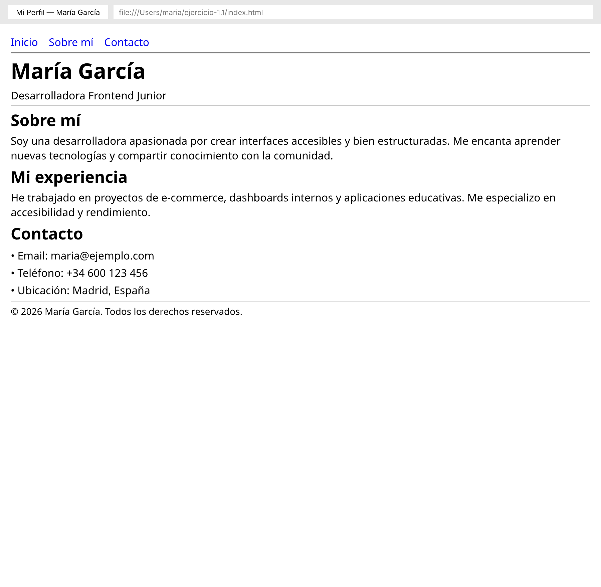

# 🟢 Actividad 1.1 — Construir un documento HTML con estructura semántica

[← Volver a Etapa 1](../README.md)

- [ ] Completada

**Duración:** ~55 min

**Lectura:**
- [HTML Semántico y el DOM](../lecturas/01-html-semantico.md) (~20 min)

## Antes de empezar

Necesitas tener completada la **Actividad 1.0** (VS Code instalado, Node.js funcionando, extensión Live Server instalada).

Antes de escribir código, entiende qué es un **archivo HTML**: es un archivo de texto plano con extensión `.html` que el navegador interpreta para mostrar una página web. Contiene **etiquetas** (tags) como `<header>`, `<p>`, `<nav>` que le dicen al navegador qué tipo de contenido es cada sección.

Un **editor de texto** como VS Code te permite crear y editar estos archivos. No uses Word ni Google Docs — esos agregan formato invisible que rompe el código. VS Code colorea las etiquetas para que las veas mejor y detecta errores de sintaxis.

## Práctica paso a paso

**Paso 1 — Crear la carpeta y el archivo**

1. Abre VS Code. Abre la carpeta `etapa-1` que creaste en la Actividad 1.0 (**File → Open Folder**)
2. En el panel izquierdo (Explorer), haz clic derecho → **New Folder** → nómbrala `ejercicio-1.1`
3. Haz clic derecho sobre `ejercicio-1.1` → **New File** → nómbralo `index.html`
4. Se abre el archivo vacío en el editor

**Paso 2 — Escribir la estructura básica (esqueleto HTML)**

1. En el archivo `index.html`, escribe este esqueleto (o cópialo de la lectura):
   ```html
   <!DOCTYPE html>
   <html lang="es">
   <head>
     <meta charset="UTF-8">
     <meta name="viewport" content="width=device-width, initial-scale=1.0">
     <title>Mi Perfil</title>
   </head>
   <body>

   </body>
   </html>
   ```
2. Guarda el archivo: `Ctrl+S` (Windows/Linux) o `Cmd+S` (Mac)

**Paso 3 — Agregar un `<header>` con tu nombre y rol**

Dentro del `<body>`, agrega:
```html
<header>
  <h1>Tu Nombre</h1>
  <p>Frontend Developer en formación</p>
</header>
```

**Paso 4 — Agregar un `<nav>` con 3 enlaces**

Debajo del `<header>`, agrega:
```html
<nav>
  <ul>
    <li><a href="#sobre-mi">Sobre mí</a></li>
    <li><a href="#proyectos">Proyectos</a></li>
    <li><a href="#contacto">Contacto</a></li>
  </ul>
</nav>
```

**Paso 5 — Agregar el contenido principal con `<main>`**

```html
<main>
  <section id="sobre-mi">
    <h2>Sobre mí</h2>
    <p>Escribe un par de párrafos sobre ti, tus intereses en tecnología, por qué quieres ser developer.</p>
  </section>

  <section id="proyectos">
    <h2>Proyectos</h2>
    <article>
      <h3>Proyecto de ejemplo</h3>
      <p>Descripción del proyecto. Qué tecnologías usaste, qué aprendiste.</p>
    </article>
  </section>
</main>
```

**Paso 6 — Agregar una barra lateral con `<aside>`**

Después del `</main>`, agrega:
```html
<aside>
  <h2>Links útiles</h2>
  <ul>
    <li><a href="https://developer.mozilla.org">MDN Web Docs</a></li>
    <li><a href="https://web.dev">web.dev</a></li>
  </ul>
</aside>
```

**Paso 7 — Agregar un `<footer>`**

```html
<footer>
  <p>&copy; 2026 Tu Nombre. Todos los derechos reservados.</p>
</footer>
```

**Paso 8 — Abrir tu página en el navegador**

Hay dos formas:

- **Opción A (Live Server):** Haz clic derecho en `index.html` en el Explorer de VS Code → **Open with Live Server**. Se abre automáticamente en tu navegador. Cada vez que guardes, la página se actualiza sola.
- **Opción B (manual):** Ve al explorador de archivos de tu sistema operativo, navega hasta la carpeta `ejercicio-1.1`, y haz doble clic en `index.html`. Se abre en tu navegador predeterminado.

**Paso 9 — Verificar la estructura en DevTools**

1. Con la página abierta en el navegador, presiona `F12` para abrir DevTools
2. Ve a la pestaña **Elements** (Chrome) o **Inspector** (Firefox)
3. Expande las etiquetas. Deberías ver: `<header>`, `<nav>`, `<main>`, `<aside>`, `<footer>` — sin ningún `<div>` para estructura
4. Verifica que hay exactamente un `<h1>` y que los encabezados siguen el orden h1 → h2 → h3 sin saltarse niveles

## Validación paso a paso

1. Abre la terminal en VS Code: `Ctrl+`\` o **Terminal → New Terminal**
2. Navega a tu carpeta: `cd ejercicio-1.1`
3. Ejecuta: `npx html-validate index.html`
   - La primera vez que ejecutes un comando `npx`, puede preguntarte si deseas instalar el paquete. Escribe `y` y presiona Enter
4. Si ves **"0 errors found"**, tu HTML es válido
5. Si ves errores, lee cada mensaje — te dice el número de línea y qué está mal. Corrige y vuelve a ejecutar

## ¿Qué puede salir mal?

- **"Abrí el archivo pero veo el código, no la página"** — Estás abriendo `index.html` en un editor de texto. Necesitas abrirlo en un **navegador** (Chrome, Firefox, etc.). Haz doble clic en el archivo desde el explorador de archivos de tu sistema operativo, o usa Live Server desde VS Code
- **"Mi página se ve como texto sin formato"** — Revisa que las etiquetas estén bien escritas y cerradas. Un `<header` sin el `>` de cierre rompe todo lo que sigue
- **"html-validate dice que falta DOCTYPE"** — Asegúrate de que la primera línea de tu archivo sea exactamente `<!DOCTYPE html>` (sin espacios antes)

## Resultado esperado

Tu página debe mostrarse en el navegador con texto visible: tu nombre como título grande, un menú de navegación, secciones de contenido, una barra lateral y un pie de página. No tendrá estilos bonitos aún (eso viene en la Actividad 1.3), pero la estructura semántica es correcta.



**Criterios de aceptación:**
- [ ] Cero `div` usados para layout estructural
- [ ] Pasa html-validate sin errores
- [ ] Exactamente un `h1`, jerarquía sin saltos

---

[← Anterior](./1.0-entorno-de-desarrollo.md) | [Siguiente →](./1.2-formulario-contacto.md)
