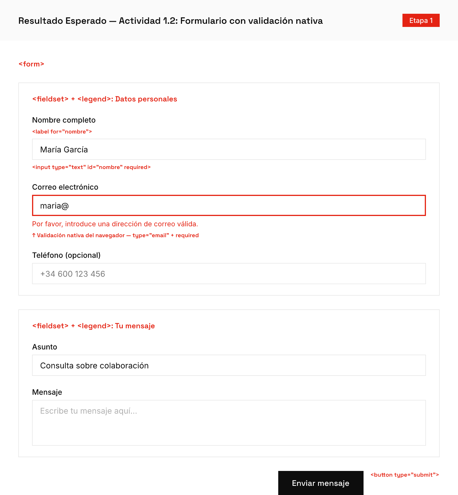

# 🟢 Actividad 1.2 — Agregar formularios con validación nativa

[← Volver a Etapa 1](../README.md)

- [ ] Completada

**Duración:** ~50 min

**Lectura:**
- [Formularios Nativos](../lecturas/02-formularios-nativos.md) (~10 min)

## Antes de empezar

Necesitas haber completado la **Actividad 1.1** (página de perfil con HTML semántico).

¿Qué es un **formulario** en HTML? No es solo algo visual — es la forma estándar de **recoger datos del usuario**. Cuando llenas tu nombre y correo en una página web, estás usando un formulario. HTML tiene etiquetas especiales para esto (`<form>`, `<input>`, `<label>`) que además incluyen **validación nativa**: el navegador puede verificar automáticamente que un email tiene `@`, que un campo obligatorio no esté vacío, etc., sin necesidad de JavaScript.

## Práctica paso a paso

**Paso 1 — Abrir tu archivo existente**

1. Abre VS Code con tu carpeta `etapa-1`
2. Abre el archivo `ejercicio-1.1/index.html` (el de tu perfil)

**Paso 2 — Agregar una sección para el formulario de contacto**

Dentro del `<main>`, después de la última `</section>`, agrega una nueva sección:
```html
<section id="contacto">
  <h2>Contacto</h2>
  <!-- aquí irá el formulario -->
</section>
```

**Paso 3 — Agregar el `<form>` con `<fieldset>` y `<legend>`**

Dentro de la nueva sección, reemplaza el comentario con:
```html
<form action="#" method="POST">
  <fieldset>
    <legend>Envíame un mensaje</legend>
    <!-- aquí irán los campos -->
  </fieldset>
</form>
```

`<fieldset>` agrupa campos relacionados visualmente (dibuja un borde alrededor). `<legend>` es el título del grupo.

**Paso 4 — Agregar campos con `<label>` y `<input>` asociados**

Dentro del `<fieldset>`, después del `<legend>`, agrega:
```html
<div>
  <label for="nombre">Nombre completo</label>
  <input type="text" id="nombre" name="nombre" required>
</div>

<div>
  <label for="email">Correo electrónico</label>
  <input type="email" id="email" name="email" required>
</div>

<div>
  <label for="mensaje">Mensaje</label>
  <textarea id="mensaje" name="mensaje" rows="4" required></textarea>
</div>
```

Nota que el atributo `for` del `<label>` debe coincidir **exactamente** con el `id` del `<input>`. Esto conecta visualmente el label con su campo — cuando el usuario hace clic en el texto del label, el cursor salta al campo correspondiente.

**Paso 5 — Agregar un botón de envío**

Después del último `</div>`, dentro del `<fieldset>`:
```html
<button type="submit">Enviar mensaje</button>
```

**Paso 6 — Agregar validación con `pattern`**

Para el campo de nombre, agrega un patrón que requiera al menos 2 caracteres:
```html
<input type="text" id="nombre" name="nombre" required minlength="2">
```

**Paso 7 — Probar la validación nativa**

1. Abre la página en el navegador (Live Server o doble clic)
2. Sin llenar ningún campo, haz clic en "Enviar mensaje"
3. El navegador debe mostrar un mensaje como "Completa este campo" en el primer campo vacío
4. Llena el nombre pero escribe un email sin `@` (ejemplo: "hola"). Haz clic en enviar
5. El navegador debe decirte que el email no es válido

**Paso 8 — Verificar asociación de labels en DevTools**

1. Presiona `F12` para abrir DevTools
2. Haz clic en la pestaña **Elements**
3. Haz clic en el ícono de seleccionar elemento (esquina superior izquierda de DevTools, parece un cursor con un cuadrado)
4. Haz clic en un `<label>` en la página
5. En el panel de Elements, verifica que el `for` coincide con el `id` del input correspondiente

## Validación paso a paso

1. Abre la terminal: `` Ctrl+` `` o **Terminal → New Terminal**
2. Navega a tu carpeta: `cd ejercicio-1.1`
3. Ejecuta: `npx html-validate index.html`
4. Si ves **"0 errors found"**, todo está bien
5. Si ves un error sobre labels, verifica que cada `for` coincide con un `id`

## ¿Qué puede salir mal?

- **"Mis labels no resaltan el input cuando hago clic"** — El atributo `for` del label no coincide con el `id` del input. Deben ser **exactamente** iguales, incluyendo mayúsculas/minúsculas. `for="Email"` no conecta con `id="email"`
- **"No aparece ningún mensaje de error al enviar vacío"** — Verifica que los campos tienen el atributo `required` (sin valor, solo la palabra). También verifica que tu `<button>` tiene `type="submit"` y está **dentro** del `<form>`
- **"El formulario se envía y la página se recarga"** — Eso es el comportamiento normal. El `action="#"` hace que la página se recargue sin ir a ningún lado. En actividades futuras aprenderás a manejar el envío con JavaScript

## Resultado esperado

Tu página de perfil ahora tiene una sección de contacto con un formulario funcional. Los campos obligatorios muestran mensajes de error nativos del navegador cuando intentas enviar sin completarlos. Al hacer clic en cualquier label, el cursor salta al campo correspondiente.



**Criterios de aceptación:**
- [ ] Cada `input` tiene un `label` asociado (for/id)
- [ ] Los campos requeridos muestran error nativo al enviar vacío
- [ ] El `fieldset` agrupa campos relacionados con `legend`

---

[← Anterior](./1.1-perfil-semantico.md) | [Siguiente →](./1.3-box-model-flexbox.md)
