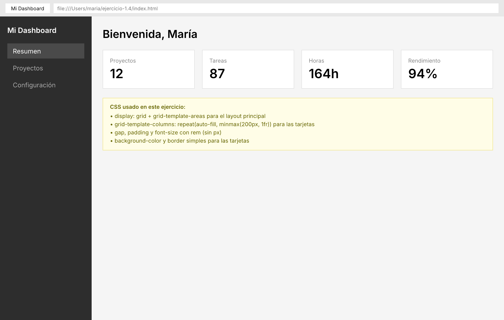

# 🟢 Actividad 1.4 — Construir layouts con CSS Grid

[Inicio](../../README.md) > [Etapa 1](../README.md) > Actividad 1.4

- [ ] Completada

**Duración:** ~60 min

## Por qué esta actividad

Flexbox resuelve layouts en una dimensión (fila o columna), pero cuando necesitas controlar filas **y** columnas al mismo tiempo — como un dashboard con header, sidebar y contenido — necesitas CSS Grid. Es el sistema de layout bidimensional del navegador, y dominarlo te permite construir interfaces complejas sin hacks ni frameworks CSS.

| | |
|---|---|
| **Requiere** | Actividad 1.3 completada (CSS, box model, Flexbox) |
| **Aprenderás** | Definir layouts con `grid-template-areas`, crear grillas responsivas con `auto-fill` y `minmax`, usar media queries con `rem`, probar layouts en Device Toolbar de DevTools |
| **Al completar** | Un dashboard con header, sidebar y contenido usando Grid areas, más una grilla de tarjetas que se reorganiza automáticamente sin media queries |

**Pilares:** Usabilidad, Rendimiento

**Lectura:**
- [CSS Grid](../lecturas/05-css-grid.md) (~20 min)

## Antes de empezar

Necesitas haber completado la **Actividad 1.3** (saber crear y conectar archivos CSS, entender el box model).

CSS Grid es un sistema de layout bidimensional — a diferencia de Flexbox (que maneja filas **o** columnas), Grid maneja filas **y** columnas al mismo tiempo. Es ideal para layouts complejos como dashboards.

## Práctica paso a paso

**Paso 1 — Crear la estructura del proyecto**

1. En VS Code, dentro de `etapa-1`, crea una carpeta `ejercicio-1.4`
2. Dentro, crea `index.html` y `styles.css`
3. En `index.html`, escribe el esqueleto HTML básico y conecta el CSS con `<link rel="stylesheet" href="styles.css">`

**Paso 2 — Crear la estructura HTML del dashboard**

Dentro del `<body>`:
```text
<div class="dashboard">
  <header class="dashboard-header">
    <h1>Mi Dashboard</h1>
  </header>
  <nav class="dashboard-sidebar">
    <ul>
      <li><a href="#">Inicio</a></li>
      <li><a href="#">Estadísticas</a></li>
      <li><a href="#">Configuración</a></li>
    </ul>
  </nav>
  <main class="dashboard-content">
    <h2>Contenido principal</h2>
    <div class="card-grid">
      <article class="card">Tarjeta 1</article>
      <article class="card">Tarjeta 2</article>
      <article class="card">Tarjeta 3</article>
      <article class="card">Tarjeta 4</article>
      <article class="card">Tarjeta 5</article>
      <article class="card">Tarjeta 6</article>
    </div>
  </main>
</div>
```

**Paso 3 — Definir el layout con Grid areas**

En `styles.css`:
```css
*,
*::before,
*::after {
  box-sizing: border-box;
}

body {
  margin: 0;
  font-family: system-ui, sans-serif;
}

.dashboard {
  display: grid;
  grid-template-areas:
    "header  header"
    "sidebar content";
  grid-template-columns: 15rem 1fr;
  grid-template-rows: auto 1fr;
  min-height: 100vh;
}

.dashboard-header {
  grid-area: header;
  background: #2c3e50;
  color: white;
  padding: 1rem;
}

.dashboard-sidebar {
  grid-area: sidebar;
  background: #34495e;
  color: white;
  padding: 1rem;
}

.dashboard-content {
  grid-area: content;
  padding: 1.5rem;
}
```

**Paso 4 — Crear la grilla de tarjetas con `auto-fill` y `minmax`**

```css
.card-grid {
  display: grid;
  grid-template-columns: repeat(auto-fill, minmax(15rem, 1fr));
  gap: 1rem;
}

.card {
  padding: 1.5rem;
  background: #ecf0f1;
  border-radius: 0.5rem;
}
```

`repeat(auto-fill, minmax(15rem, 1fr))` significa: "crea tantas columnas como quepan, cada una de mínimo 15rem y máximo 1fr". Las tarjetas se reorganizan automáticamente según el ancho disponible — sin necesidad de media queries.

**Paso 5 — Hacer el layout responsivo para móvil**

Agrega al final de tu CSS:
```css
@media (max-width: 48rem) {
  .dashboard {
    grid-template-areas:
      "header"
      "sidebar"
      "content";
    grid-template-columns: 1fr;
  }
}
```

En pantallas angostas, el sidebar pasa debajo del header.

**Paso 6 — Probar en Device Toolbar (simulador de dispositivos)**

1. Abre la página en Chrome y presiona `F12`
2. Haz clic en el ícono de **Device Toolbar** (el ícono de teléfono/tablet en la esquina superior izquierda del panel de DevTools). También puedes presionar `Ctrl+Shift+M` (Windows/Linux) o `Cmd+Shift+M` (Mac)
3. En la barra superior del viewport, verás un menú desplegable con dispositivos predefinidos (iPhone, iPad, etc.)
4. También puedes escribir un ancho exacto. Prueba estos tres:
   - **320px** — Ancho de un teléfono pequeño. El sidebar debe estar debajo del header
   - **768px** — Ancho de una tablet. Prueba ambos layouts
   - **1280px** — Ancho de un monitor. El sidebar debe estar a la izquierda del contenido
5. Verifica que **no aparezca scroll horizontal** en ningún ancho

## Validación paso a paso

1. Abre la página en el navegador
2. Abre DevTools (`F12`) y activa Device Toolbar
3. Prueba en 320px: no debe haber scroll horizontal. Las tarjetas deben estar en una sola columna
4. Prueba en 768px: el layout debe verse razonable
5. Prueba en 1280px: sidebar a la izquierda, tarjetas en múltiples columnas
6. En ningún ancho debería haber barras de scroll horizontales

## Qué puede salir mal

- **"Mi grid tiene scrollbars horizontales en móvil"** — Si usas anchos fijos (como `grid-template-columns: 200px 1fr`), los `200px` no se encogen en pantallas pequeñas. Usa `minmax(0, 1fr)` en lugar de anchos fijos, o usa media queries para cambiar el layout en pantallas angostas
- **"Las tarjetas no se reorganizan automáticamente"** — Verifica que usas `auto-fill` (o `auto-fit`) con `minmax`, no un número fijo de columnas como `repeat(3, 1fr)`. El número fijo siempre pone 3 columnas, aunque no quepan
- **"El sidebar desaparece por completo"** — Revisa tu media query. El selector y las propiedades deben coincidir exactamente con los que definiste arriba

## Resultado esperado

Un dashboard con header en la parte superior (todo el ancho), sidebar a la izquierda, y contenido principal a la derecha con una grilla de tarjetas que se reorganizan automáticamente. En móvil, todo se apila verticalmente.



**Criterios de aceptación:**
- [ ] El layout usa CSS Grid con areas nombradas
- [ ] Las tarjetas usan `auto-fill`/`auto-fit` con `minmax` (responsivas sin media queries)
- [ ] Funciona en 3 anchos sin scroll horizontal

---

[← Anterior](./1.3-box-model-flexbox.md) | [Siguiente →](./1.5-javascript-moderno.md)
