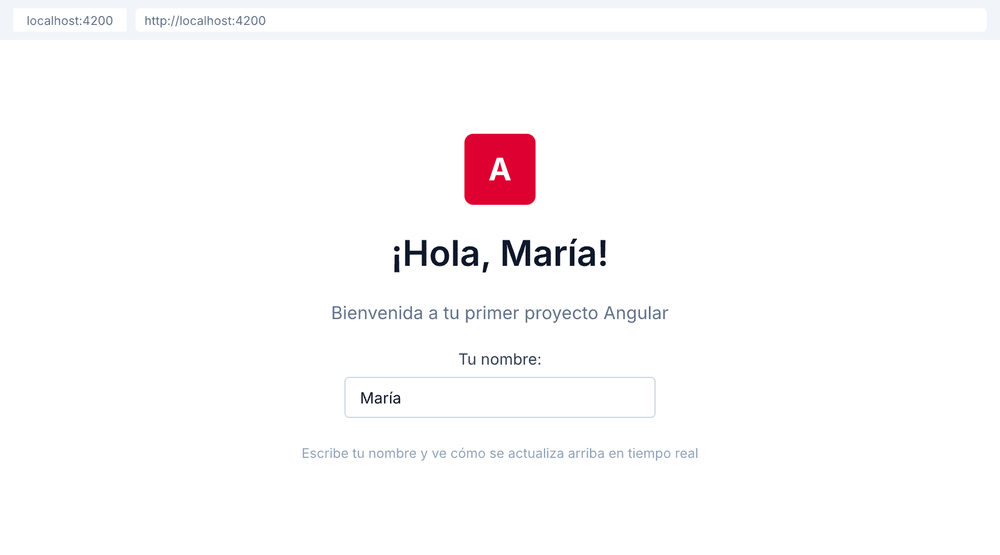

# 🟢 Actividad 2.0 — Configurar tu primer proyecto Angular

[Inicio](../../README.md) > [Etapa 2](../README.md) > Actividad 2.0

- [ ] Completada

**Duracion:** ~45 min

## Por que esta actividad

En la Etapa 1 construiste todo con HTML, CSS y JavaScript puro. Eso funciona para paginas simples, pero cuando tu aplicación crece a decenas de vistas con datos dinamicos, mantener el DOM sincronizado a mano se vuelve insostenible. Los frameworks como Angular resuelven esto con un sistema de componentes, renderizado declarativo y herramientas integradas. Esta actividad te da la base sobre la que construiras todo el resto de la etapa.

| | |
|---|---|
| **Requiere** | Etapa 1 completada (Node.js, npm, VS Code, TypeScript básico) |
| **Aprenderas** | Instalar Angular CLI, crear un proyecto con `ng new`, entender la estructura de archivos, crear un componente standalone, ejecutar `ng serve` con hot reload |
| **Al completar** | Tienes un proyecto Angular funcionando con un componente que muestra "Hola Mundo" y responde a cambios en tiempo real |

**Angular:**
- [Setup de Angular](../angular/00-setup-angular.md) (~15 min)
- [Componentes en Angular](../angular/01-componentes-en-angular.md) (~15 min)

## Antes de empezar

Necesitas haber completado toda la **Etapa 1**, especialmente las Actividades 1.0 (entorno), 1.5 (JavaScript moderno) y 1.6 (TypeScript).

**¿Que es un framework?** Es un conjunto de herramientas y convenciones que resuelven problemas comunes de desarrollo: como actualizar la pantalla cuando cambian los datos, como organizar el código en piezas reutilizables, como manejar la navegación entre vistas. En lugar de escribir todo desde cero, el framework te da una estructura y tu pones la lógica de tu aplicación.

**¿Que es Angular?** Es un framework completo (batteries-included) creado por Google. Incluye routing, formularios, cliente HTTP, dependency injection y testing integrados. Usa TypeScript por defecto, lo que significa que el código que escribiste en la Etapa 1 ya te sirve de base.

**¿Que es Angular CLI?** Es una herramienta de linea de comandos que genera proyectos y archivos con la estructura correcta. En lugar de crear carpetas y archivos a mano (lo que lleva a errores), el CLI lo hace automáticamente siguiendo las convenciones de Angular.

## Practica paso a paso

> **Pasos:** [1. Instalar Angular CLI](#paso-1--instalar-angular-cli) · [2. Crear el proyecto](#paso-2--crear-el-proyecto) · [3. Explorar la estructura](#paso-3--explorar-la-estructura) · [4. Ejecutar el servidor](#paso-4--ejecutar-el-servidor-de-desarrollo) · [5. Crear un componente](#paso-5--crear-tu-primer-componente) · [6. Usar el componente](#paso-6--usar-el-componente-en-la-app) · [7. Agregar un input](#paso-7--agregar-un-input-interactivo)

### Paso 1 — Instalar Angular CLI

1. Abre la terminal de VS Code: `` Ctrl+` `` o **Terminal → New Terminal**
2. Ejecuta:
   ```bash
   npm install -g @angular/cli
   ```
   - `-g` significa "global" — el comando `ng` estara disponible desde cualquier carpeta
3. Verifica que se instalo: `ng version` — deberas ver la versión de Angular CLI (19.x o superior)

### Paso 2 — Crear el proyecto

1. En la terminal, navega a la carpeta donde quieres crear tu proyecto (por ejemplo, tu carpeta de trabajo):
   ```bash
   cd ~/etapa-2
   ```
   Si la carpeta no existe, creala primero: `mkdir ~/etapa-2 && cd ~/etapa-2`
2. Ejecuta:
   ::: code-group
   ```bash [Angular]
   ng new mi-primera-app
   ```
   ```bash [React]
   npm create vite@latest mi-primera-app -- --template react-ts
   ```
   :::
3. El CLI te hara preguntas:
   - **Which stylesheet format?** → Selecciona `CSS` (usa las flechas y Enter)
   - **Do you want to enable Server-Side Rendering (SSR)?** → Escribe `N` y presiona Enter
4. Espera a que termine la instalacion (puede tardar 1-2 minutos)
5. Entra al directorio del proyecto:
   ```bash
   cd mi-primera-app
   ```

### Paso 3 — Explorar la estructura

1. Abre el proyecto en VS Code: `code .` (o **File → Open Folder** y selecciona `mi-primera-app`)
2. En el panel izquierdo (Explorer), expande las carpetas. Veras esta estructura:
   ```
   mi-primera-app/
     src/
       app/
         app.component.ts       ← Componente raiz (la "pagina principal")
         app.component.html     ← Template del componente raiz
         app.component.css      ← Estilos del componente raiz
         app.config.ts          ← Configuracion de la app
         app.routes.ts          ← Definicion de rutas
       index.html               ← Pagina HTML principal
       main.ts                  ← Entry point de la aplicacion
       styles.css               ← Estilos globales
     angular.json               ← Configuracion de Angular CLI
     tsconfig.json              ← Configuracion de TypeScript
     package.json               ← Dependencias del proyecto
   ```
3. Abre `src/app/app.component.ts` — este es el componente raiz. Observa el decorador `@Component` que conecta la clase con su template y estilos.

### Paso 4 — Ejecutar el servidor de desarrollo

1. En la terminal (dentro de `mi-primera-app`), ejecuta:
   ::: code-group
   ```bash [Angular]
   ng serve
   ```
   ```bash [React]
   npm run dev
   ```
   :::
2. Espera a que compile (veras mensajes de progreso). Cuando termine, veras algo como:
   ```
   Local: http://localhost:4200
   ```
3. Abre tu navegador y ve a `http://localhost:4200` — veras la página de bienvenida de Angular
4. **Deja la terminal abierta** — `ng serve` mantiene el servidor corriendo y recarga la página automáticamente cuando guardas cambios

### Paso 5 — Crear tu primer componente

1. Abre **otra terminal** en VS Code: **Terminal → New Terminal** (o el icono `+` en el panel de terminal)
2. Asegurate de estar en la carpeta del proyecto (`mi-primera-app`)
3. Ejecuta:
   ::: code-group
   ```bash [Angular]
   ng generate component greeting
   ```
   ```bash [React]
   # Los componentes en React se crean como archivos .tsx directamente
   touch src/components/Greeting.tsx
   ```
   :::
   - Shorthand: `ng g c greeting`
4. El CLI crea 4 archivos en `src/app/greeting/`:
   - `greeting.component.ts` — la clase del componente
   - `greeting.component.html` — el template
   - `greeting.component.css` — los estilos
   - `greeting.component.spec.ts` — el archivo de tests

5. Abre `src/app/greeting/greeting.component.ts` y reemplaza su contenido por:
   ::: code-group
   ```typescript [Angular]
   import { Component } from '@angular/core';

   @Component({
     selector: 'app-greeting',
     standalone: true,
     templateUrl: './greeting.component.html',
     styleUrl: './greeting.component.css',
   })
   export class GreetingComponent {
     name = 'Mundo';
   }
   ```
   <<< @/snippets/react/act-2.0-01.tsx [React]
   :::

6. Abre `src/app/greeting/greeting.component.html` y reemplaza su contenido por:
   ```text
   <!-- HTML: template del componente greeting -->
   <h1>Hola, {{ name }}!</h1>
   ```

> 💡 **Nota:** la interpolación `name` es **interpolacion** — Angular reemplaza eso por el valor de la propiedad `name` de la clase. Es como los template literals de JavaScript (`` `${name}` ``) pero en HTML.

### Paso 6 — Usar el componente en la app

1. Abre `src/app/app.component.ts`
2. Importa el componente y agregalo a `imports`:
   ::: code-group
   ```typescript [Angular]
   import { Component } from '@angular/core';
   import { GreetingComponent } from './greeting/greeting.component';

   @Component({
     selector: 'app-root',
     standalone: true,
     imports: [GreetingComponent],
     templateUrl: './app.component.html',
     styleUrl: './app.component.css',
   })
   export class AppComponent {
     title = 'mi-primera-app';
   }
   ```
   <<< @/snippets/react/act-2.0-02.tsx [React]
   :::
3. Abre `src/app/app.component.html`, borra todo su contenido y escribe:
   ```text
   <!-- HTML: usa tu componente greeting -->
   <app-greeting />
   ```
4. Guarda ambos archivos (`Ctrl+S` / `Cmd+S`). El navegador se actualiza automáticamente y deberas ver: **Hola, Mundo!**

### Paso 7 — Agregar un input interactivo

1. Abre `src/app/greeting/greeting.component.html` y cambia su contenido a:
   ```text
   <!-- HTML: greeting con input interactivo -->
   <label for="nameInput">Tu nombre:</label>
   <input id="nameInput" type="text" [value]="name" (input)="name = $any($event.target).value" />
   <h1>Hola, {{ name }}!</h1>
   ```
2. Guarda. En el navegador, escribe tu nombre en el campo de texto — el titulo se actualiza en tiempo real
3. Cambia el texto "Mundo" en `greeting.component.ts` a tu nombre. Guarda. El navegador se actualiza automáticamente — eso es **hot reload**

## Que puede salir mal

- **"El comando `ng` no se reconoce"** → Angular CLI no se instalo globalmente. Ejecuta `npm install -g @angular/cli` de nuevo. Si usas Mac/Linux y da error de permisos, usa `sudo npm install -g @angular/cli`.
- **"Port 4200 is already in use"** → Ya tienes otro servidor corriendo en ese puerto. Cierra la otra terminal o ejecuta `ng serve --port 4300` para usar otro puerto.
- **"El componente no aparece en el navegador"** → Verifica que importaste `GreetingComponent` en el array `imports` de `app.component.ts`. Sin el import, Angular no sabe que el componente existe.
- **"Error: NG8001 'app-greeting' is not a known element"** → Mismo problema: falta el import en `app.component.ts`. Asegurate de tener `imports: [GreetingComponent]` en el decorador `@Component`.

## Resultado esperado

En el navegador (`http://localhost:4200`) ves un campo de texto y un titulo que dice "Hola, [tu nombre]!". Al escribir en el campo de texto, el titulo se actualiza en tiempo real. Al cambiar cualquier archivo y guardar, el navegador se actualiza automáticamente.



**Criterios de aceptacion:**
- [ ] `ng new` ejecutado exitosamente y el proyecto compila sin errores
- [ ] Un componente standalone `GreetingComponent` creado y visible en el navegador
- [ ] `ng serve` ejecuta sin errores y hot reload funciona (cambiar texto → se refleja automáticamente)

**Pilares de diseño que ejercita esta actividad:**
- **Mantenibilidad** — el sistema de componentes de Angular organiza el código en piezas pequenas y reutilizables desde el inicio

---

[← Etapa 1](../../stage-1-foundations/) | [Siguiente →](./2.1-descomponer-ui.md)
