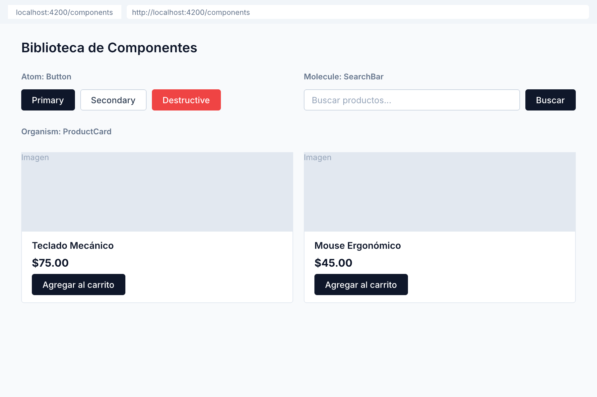

# 🟢 Actividad 2.2 — Construir una biblioteca de componentes de 3 niveles

[Inicio](../../README.md) > [Etapa 2](../README.md) > Actividad 2.2

- [ ] Completada

**Duracion:** ~55 min

## Por que esta actividad

Saber identificar componentes (Actividad 2.1) es el primer paso. Ahora necesitas **construirlos de verdad** con props tipados, valores por defecto y composicion real. Vas a crear 3 componentes que representan los 3 niveles de Atomic Design (atom, molecule, organism) y los vas a componer: un Button dentro de un SearchBar, un SearchBar dentro de un ProductCard. Esto te da la experiencia practica de como los componentes se comunican y se anidan.

| | |
|---|---|
| **Requiere** | Actividad 2.1 completada (descomposicion de UI documentada, componentes generados) |
| **Aprenderas** | Definir interfaces TypeScript para props de componentes, usar `input()` y `output()` en Angular, componer componentes dentro de otros, disenar APIs con defaults razonables |
| **Al completar** | Tienes 3 componentes Angular (Button, SearchBar, ProductCard) que componen entre si, con props tipados y TypeScript compilando sin errores |

**Lectura:**
- [API de Componentes](../lecturas/02-api-de-componentes.md) (~15 min)

**Angular:**
- [API de Componentes en Angular](../angular/02-api-de-componentes-angular.md) (~10 min)

## Antes de empezar

Necesitas haber completado la **Actividad 2.1** (descomposicion de UI).

**¿Que es un input en Angular?** Es la forma en que un componente padre le pasa datos a un componente hijo. En Angular 19+ se usan signals: `name = input<string>('')`. Los inputs se leen llamando la función: `name()`, no `name`. El padre los pasa en el template con `[name]="valor"`.

**¿Que es un output en Angular?** Es la forma en que un componente hijo le avisa algo al padre. Se define como `clicked = output<void>()` y se emite con `this.clicked.emit()`. El padre lo escucha con `(clicked)="handleClick()"`.

**¿Que es content projection?** Es el equivalente Angular de `children` en React o `<slot>` en Vue. Permite que el padre inyecte contenido dentro del hijo usando `<ng-content />`.

## Practica paso a paso

> **Pasos:** [1. Crear el Button](#paso-1--crear-el-componente-button-atom) · [2. Crear el SearchBar](#paso-2--crear-el-componente-searchbar-molecule) · [3. Crear el ProductCard](#paso-3--crear-el-componente-productcard-organism) · [4. Componer todo](#paso-4--componer-los-tres-niveles) · [5. Verificar](#paso-5--verificar-en-el-navegador)

### Paso 1 — Crear el componente Button (Atom)

Un atom es el componente mas básico — no contiene otros componentes.

1. En la terminal, genera el componente:
   ```bash
   ng g c button
   ```

2. Abre `src/app/button/button.component.ts` y reemplaza su contenido por:
   ```typescript
   import { Component, input, output } from '@angular/core';

   @Component({
     selector: 'app-button',
     standalone: true,
     templateUrl: './button.component.html',
     styleUrl: './button.component.css',
   })
   export class ButtonComponent {
     label = input.required<string>();
     variant = input<'primary' | 'secondary'>('primary');
     disabled = input<boolean>(false);
     clicked = output<void>();

     handleClick() {
       if (!this.disabled()) {
         this.clicked.emit();
       }
     }
   }
   ```

3. Abre `src/app/button/button.component.html` y reemplaza por:
   ```text
   <!-- HTML: template del Button -->
   <button
     [class]="'btn btn-' + variant()"
     [disabled]="disabled()"
     (click)="handleClick()"
   >
     {{ label() }}
   </button>
   ```

4. Abre `src/app/button/button.component.css` y agrega:
   ```css
   .btn {
     padding: 0.5rem 1rem;
     border: none;
     border-radius: 4px;
     cursor: pointer;
     font-size: 1rem;
   }

   .btn-primary {
     background-color: #2563eb;
     color: white;
   }

   .btn-secondary {
     background-color: #e5e7eb;
     color: #1f2937;
   }

   .btn:disabled {
     opacity: 0.5;
     cursor: not-allowed;
   }
   ```

> 💡 **Nota:** Observa que `variant` tiene un valor por defecto `'primary'`. Esto significa que el consumidor puede usar `<app-button label="Guardar" />` sin especificar `variant` y obtendra un botón primario. Eso es un "default razonable".

### Paso 2 — Crear el componente SearchBar (Molecule)

Un molecule combina varios atoms para formar una unidad funcional.

1. Genera el componente:
   ```bash
   ng g c search-bar
   ```

2. Abre `src/app/search-bar/search-bar.component.ts` y reemplaza por:
   ```typescript
   import { Component, input, output, signal } from '@angular/core';
   import { ButtonComponent } from '../button/button.component';

   @Component({
     selector: 'app-search-bar',
     standalone: true,
     imports: [ButtonComponent],
     templateUrl: './search-bar.component.html',
     styleUrl: './search-bar.component.css',
   })
   export class SearchBarComponent {
     placeholder = input<string>('Buscar...');
     searched = output<string>();

     query = signal('');

     onSearch() {
       this.searched.emit(this.query());
     }

     onInput(event: Event) {
       const target = event.target as HTMLInputElement;
       this.query.set(target.value);
     }
   }
   ```

3. Abre `src/app/search-bar/search-bar.component.html` y reemplaza por:
   ```text
   <!-- HTML: template del SearchBar -->
   <div class="search-bar">
     <input
       type="text"
       [placeholder]="placeholder()"
       [value]="query()"
       (input)="onInput($event)"
     />
     <app-button label="Buscar" (clicked)="onSearch()" />
   </div>
   ```

4. Abre `src/app/search-bar/search-bar.component.css` y agrega:
   ```css
   .search-bar {
     display: flex;
     gap: 0.5rem;
     align-items: center;
   }

   input {
     padding: 0.5rem;
     border: 1px solid #d1d5db;
     border-radius: 4px;
     font-size: 1rem;
     flex: 1;
   }
   ```

> 💡 **Nota:** Observa como `SearchBarComponent` importa `ButtonComponent` en su array `imports`. Asi es como Angular sabe que `<app-button>` existe dentro de este template. Sin ese import, veras un error.

### Paso 3 — Crear el componente ProductCard (Organism)

Un organism es un componente complejo que combina multiples molecules y atoms.

1. Genera el componente:
   ```bash
   ng g c product-card
   ```

2. Abre `src/app/product-card/product-card.component.ts` y reemplaza por:
   ```typescript
   import { Component, input, output } from '@angular/core';
   import { CurrencyPipe } from '@angular/common';
   import { ButtonComponent } from '../button/button.component';

   @Component({
     selector: 'app-product-card',
     standalone: true,
     imports: [ButtonComponent, CurrencyPipe],
     templateUrl: './product-card.component.html',
     styleUrl: './product-card.component.css',
   })
   export class ProductCardComponent {
     name = input.required<string>();
     price = input.required<number>();
     description = input<string>('');
     imageUrl = input<string>('');
     addedToCart = output<string>();

     onAddToCart() {
       this.addedToCart.emit(this.name());
     }
   }
   ```

3. Abre `src/app/product-card/product-card.component.html` y reemplaza por:
   ```text
   <!-- HTML: template del ProductCard -->
   <article class="product-card">
     @if (imageUrl()) {
       
     }
     <div class="product-body">
       <h3>{{ name() }}</h3>
       <p class="price">{{ price() | currency }}</p>
       @if (description()) {
         <p class="description">{{ description() }}</p>
       }
       <app-button label="Agregar al carrito" (clicked)="onAddToCart()" />
     </div>
   </article>
   ```

4. Abre `src/app/product-card/product-card.component.css` y agrega:
   ```css
   .product-card {
     border: 1px solid #e5e7eb;
     border-radius: 8px;
     overflow: hidden;
     max-width: 300px;
   }

   .product-image {
     width: 100%;
     height: 200px;
     object-fit: cover;
   }

   .product-body {
     padding: 1rem;
   }

   .price {
     font-size: 1.25rem;
     font-weight: bold;
     color: #059669;
   }

   .description {
     color: #6b7280;
     font-size: 0.875rem;
   }
   ```

### Paso 4 — Componer los tres niveles

1. Abre `src/app/app.component.ts` y agrega los imports:
   ```typescript
   import { Component } from '@angular/core';
   import { SearchBarComponent } from './search-bar/search-bar.component';
   import { ProductCardComponent } from './product-card/product-card.component';

   @Component({
     selector: 'app-root',
     standalone: true,
     imports: [SearchBarComponent, ProductCardComponent],
     templateUrl: './app.component.html',
     styleUrl: './app.component.css',
   })
   export class AppComponent {
     onSearch(query: string) {
       console.log('Busqueda:', query);
     }

     onAddToCart(productName: string) {
       console.log('Agregado al carrito:', productName);
     }
   }
   ```

2. Abre `src/app/app.component.html` y reemplaza todo por:
   ```text
   <!-- HTML: composicion de los 3 niveles -->
   <main style="padding: 2rem;">
     <h1>Mi Tienda</h1>

     <app-search-bar
       placeholder="Buscar productos..."
       (searched)="onSearch($event)"
     />

     <div style="display: flex; gap: 1rem; margin-top: 2rem; flex-wrap: wrap;">
       <app-product-card
         name="Teclado Mecanico"
         [price]="89.99"
         description="Teclado mecanico con switches Cherry MX Blue"
         (addedToCart)="onAddToCart($event)"
       />
       <app-product-card
         name="Mouse Ergonomico"
         [price]="45.50"
         description="Mouse vertical para reducir fatiga en la muneca"
         (addedToCart)="onAddToCart($event)"
       />
     </div>
   </main>
   ```

### Paso 5 — Verificar en el navegador

1. Asegurate de que `ng serve` sigue corriendo. Si no, ejecutalo: `ng serve`
2. Abre `http://localhost:4200` en el navegador
3. Deberas ver:
   - Una barra de busqueda con un campo de texto y un botón "Buscar"
   - Dos tarjetas de producto con nombre, precio, descripción y botón "Agregar al carrito"
4. Abre DevTools (`F12`) → pestaña **Console**
5. Escribe algo en la barra de busqueda y haz clic en "Buscar" — deberas ver `Busqueda: [tu texto]` en la consola
6. Haz clic en "Agregar al carrito" en una tarjeta — deberas ver `Agregado al carrito: [nombre del producto]` en la consola

## Que puede salir mal

- **"Error: NG8001 'app-button' is not a known element"** → Olvidaste importar `ButtonComponent` en el componente que lo usa. Agrega `ButtonComponent` al array `imports` del decorador `@Component` del componente padre.
- **"No me aparece el precio formateado"** → Verifica que importaste `CurrencyPipe` de `@angular/common` en el array `imports` de `ProductCardComponent`.
- **"El botón no hace nada cuando hago clic"** → Verifica que estas usando `(clicked)` (con parentesis) en el template para escuchar el output. Si usas `[clicked]` (con corchetes) estas intentando pasar un input, no escuchar un evento.
- **"TypeScript dice que falta una propiedad"** → Si un input es `input.required<T>()`, el padre DEBE pasarlo. Verifica que estas pasando todos los inputs requeridos en el template.

## Resultado esperado

En el navegador ves una página con una barra de busqueda y dos tarjetas de producto. Los botones funcionan y los eventos se registran en la consola. La composicion funciona: Button vive dentro de SearchBar, Button también vive dentro de ProductCard. Cada componente tiene menos de 50 lineas de TypeScript.



**Criterios de aceptacion:**
- [ ] Cada componente tiene una interfaz TypeScript para sus props (via `input()` y `output()` tipados)
- [ ] Button funciona dentro de SearchBar y dentro de ProductCard (composicion real)
- [ ] Ningun componente excede 150 lineas (verificar con `wc -l src/app/*/\*.component.ts`)
- [ ] `ng build` compila sin errores de TypeScript

**Pilares de diseño que ejercita esta actividad:**
- **Mantenibilidad** — componentes pequenos, tipados y componibles son mas faciles de cambiar
- **Usabilidad** — defaults razonables hacen que los componentes sean faciles de usar sin configuración innecesaria

---

[← Anterior](./2.1-descomponer-ui.md) | [Siguiente →](./2.3-srp-refactorizar.md)
