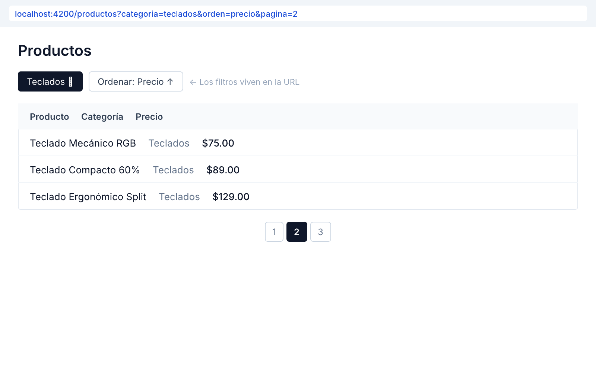

# 🟢 Actividad 3.2 — Gestionar estado en la URL

[Inicio](../../README.md) > [Etapa 3](../README.md) > Actividad 3.2

- [ ] Completada

**Duración:** ~60 min

## Por qué esta actividad

Imagina que filtras una lista de productos por categoría "electrónica", ordenas por precio, y estás en la página 3. Si recargas la página, ¿se mantiene esa vista? Si copias la URL y la envías a un compañero, ¿ve lo mismo que tú? Si usaste `useState` o signals para guardar esos filtros, la respuesta es **no** — todo se pierde al recargar. La URL es el gestor de estado más poderoso y más ignorado del navegador: es persistente, compartible, y el botón "Atrás" funciona gratis.

| | |
|---|---|
| **Requiere** | Actividad 3.1 completada (sabes consumir APIs y manejar estados de UI) |
| **Aprenderás** | Usar query params de la URL como fuente de verdad para filtros, orden y paginación. Sincronizar la URL con la vista usando el Router de Angular. Hacer que el botón "Atrás" del navegador funcione correctamente |
| **Al completar** | Tienes una lista filtrable, ordenable y paginada donde filtro, orden y página viven en la URL. Compartir la URL reproduce la vista exacta en una ventana de incógnito |

**Lectura:**
- [URL State](../lecturas/02-url-state.md) (~15 min)

**Angular:**
- [Router y URL State en Angular](../angular/05-router-y-url-state.md) (~10 min)

## Antes de empezar

Necesitas tener completada la **Actividad 3.1** — un componente que consume una API y muestra datos.

Los **query params** son los valores que ves después del `?` en una URL: `https://tienda.com/productos?category=electronics&sort=price&page=3`. Cada par `clave=valor` es un query param. El navegador los conserva al recargar y puedes compartirlos con otra persona.

El **Router de Angular** es el módulo que se encarga de la navegación. Además de cambiar entre páginas, puede leer y escribir query params — esto lo convierte en un gestor de estado gratuito para filtros, búsquedas y paginación.

## Práctica paso a paso

> **Pasos:** [1. Configurar Router](#paso-1--configurar-el-router) · [2. Leer query params](#paso-2--leer-query-params-al-cargar) · [3. Filtro de categoría](#paso-3--agregar-filtro-de-categoría) · [4. Ordenamiento](#paso-4--agregar-ordenamiento) · [5. Paginación](#paso-5--agregar-paginación) · [6. Validar](#paso-6--validar-la-url-como-fuente-de-verdad)

### Paso 1 — Configurar el Router

1. Abre `src/app/app.config.ts` y agrega `provideRouter`:

```typescript
// src/app/app.config.ts
import { ApplicationConfig } from '@angular/core';
import { provideHttpClient } from '@angular/common/http';
import { provideRouter } from '@angular/router';
import { routes } from './app.routes';

export const appConfig: ApplicationConfig = {
  providers: [
    provideHttpClient(),
    provideRouter(routes)
  ]
};
```

2. Abre (o crea) `src/app/app.routes.ts`:

```typescript
// src/app/app.routes.ts
import { Routes } from '@angular/router';
import { ProductListComponent } from './product-list/product-list.component';

export const routes: Routes = [
  { path: '', component: ProductListComponent }
];
```

3. En `src/app/app.component.ts`, usa `<router-outlet>`:

```typescript
// src/app/app.component.ts
import { Component } from '@angular/core';
import { RouterOutlet } from '@angular/router';

@Component({
  selector: 'app-root',
  standalone: true,
  imports: [RouterOutlet],
  template: `
    <main>
      <h1>Tienda de Productos</h1>
      <router-outlet />
    </main>
  `
})
export class AppComponent {}
```

### Paso 2 — Leer query params al cargar

1. Abre `src/app/product-list/product-list.component.ts`
2. Agrega la lectura de query params:

```typescript
// src/app/product-list/product-list.component.ts
import { Component, inject, signal, OnInit } from '@angular/core';
import { ActivatedRoute, Router } from '@angular/router';
import { ProductsService, Product } from '../services/products.service';

type UIState = 'loading' | 'success' | 'error' | 'empty';

@Component({
  selector: 'app-product-list',
  standalone: true,
  templateUrl: './product-list.component.html',
  styleUrl: './product-list.component.css'
})
export class ProductListComponent implements OnInit {
  private productsService = inject(ProductsService);
  private route = inject(ActivatedRoute);
  private router = inject(Router);

  state = signal<UIState>('loading');
  products = signal<Product[]>([]);
  filteredProducts = signal<Product[]>([]);
  errorMessage = signal('');

  category = signal('all');
  sortBy = signal('default');
  page = signal(1);
  pageSize = 6;

  ngOnInit() {
    // Leer query params de la URL al cargar
    this.route.queryParams.subscribe(params => {
      this.category.set(params['category'] || 'all');
      this.sortBy.set(params['sort'] || 'default');
      this.page.set(Number(params['page']) || 1);
      this.loadProducts();
    });
  }

  loadProducts() {
    this.state.set('loading');
    this.productsService.getProducts().subscribe({
      next: (data) => {
        if (data.length === 0) {
          this.state.set('empty');
          return;
        }
        this.products.set(data);
        this.applyFilters();
        this.state.set('success');
      },
      error: () => {
        this.errorMessage.set('No pudimos cargar los productos.');
        this.state.set('error');
      }
    });
  }

  applyFilters() {
    let result = [...this.products()];

    // Filtrar por categoría
    if (this.category() !== 'all') {
      result = result.filter(p =>
        p.category === this.category()
      );
    }

    // Ordenar
    if (this.sortBy() === 'price-asc') {
      result.sort((a, b) => a.price - b.price);
    } else if (this.sortBy() === 'price-desc') {
      result.sort((a, b) => b.price - a.price);
    }

    // Paginar
    const start = (this.page() - 1) * this.pageSize;
    result = result.slice(start, start + this.pageSize);

    this.filteredProducts.set(result);
  }

  updateFilters(category: string, sort: string, page: number) {
    // Actualizar la URL — esto dispara queryParams.subscribe
    this.router.navigate([], {
      queryParams: { category, sort, page },
      queryParamsHandling: 'merge'
    });
  }
}
```

> 💡 **Nota:** `this.router.navigate([], { queryParams: ... })` cambia la URL sin recargar la página. El `queryParams.subscribe` detecta el cambio y aplica los filtros. Así la URL siempre es la fuente de verdad.

### Paso 3 — Agregar filtro de categoría

1. Abre `src/app/product-list/product-list.component.html`
2. Agrega los controles de filtro al inicio del template:

```text
<!-- HTML: src/app/product-list/product-list.component.html -->
<div class="filters">
  <label>
    Categoría:
    <select (change)="updateFilters($any($event.target).value, sortBy(), 1)">
      <option value="all" [selected]="category() === 'all'">Todas</option>
      <option value="electronics" [selected]="category() === 'electronics'">Electrónica</option>
      <option value="jewelery" [selected]="category() === 'jewelery'">Joyería</option>
      <option value="men's clothing" [selected]="category() === \"men's clothing\"">Ropa hombre</option>
      <option value="women's clothing" [selected]="category() === \"women's clothing\"">Ropa mujer</option>
    </select>
  </label>
</div>

@if (state() === 'loading') {
  <div class="skeleton-list">
    <div class="skeleton-card"></div>
    <div class="skeleton-card"></div>
    <div class="skeleton-card"></div>
  </div>
}

@if (state() === 'error') {
  <div class="error-state">
    <p>{{ errorMessage() }}</p>
    <button (click)="loadProducts()">Reintentar</button>
  </div>
}

@if (state() === 'empty') {
  <div class="empty-state">
    <h2>No hay productos en esta categoría</h2>
    <p>Prueba cambiando el filtro.</p>
  </div>
}

@if (state() === 'success') {
  <ul class="product-list">
    @for (product of filteredProducts(); track product.id) {
      <li class="product-card">
        <h3>{{ product.title }}</h3>
        <p class="price">$ {{ product.price }}</p>
      </li>
    }
  </ul>
}
```

### Paso 4 — Agregar ordenamiento

1. Dentro del `<div class="filters">`, después del select de categoría, agrega:

```text
<!-- HTML: agrega esto dentro de <div class="filters">, después del primer <label> -->
  <label>
    Ordenar:
    <select (change)="updateFilters(category(), $any($event.target).value, 1)">
      <option value="default" [selected]="sortBy() === 'default'">Sin orden</option>
      <option value="price-asc" [selected]="sortBy() === 'price-asc'">Precio: menor a mayor</option>
      <option value="price-desc" [selected]="sortBy() === 'price-desc'">Precio: mayor a menor</option>
    </select>
  </label>
```

### Paso 5 — Agregar paginación

1. Después del bloque `@if (state() === 'success')`, agrega los controles de paginación:

```text
<!-- HTML: agrega esto después del bloque de success -->
@if (state() === 'success') {
  <div class="pagination">
    <button
      [disabled]="page() <= 1"
      (click)="updateFilters(category(), sortBy(), page() - 1)">
      ← Anterior
    </button>
    <span>Página {{ page() }}</span>
    <button
      (click)="updateFilters(category(), sortBy(), page() + 1)">
      Siguiente →
    </button>
  </div>
}
```

2. En el archivo CSS, agrega estilos para los filtros y paginación:

```css
/* Agrega esto al final de product-list.component.css */
.filters {
  display: flex;
  gap: 1rem;
  margin-bottom: 1.5rem;
  flex-wrap: wrap;
}

.filters label {
  display: flex;
  align-items: center;
  gap: 0.5rem;
}

.pagination {
  display: flex;
  justify-content: center;
  align-items: center;
  gap: 1rem;
  margin-top: 1.5rem;
}

.pagination button:disabled {
  opacity: 0.5;
  cursor: not-allowed;
}
```

### Paso 6 — Validar la URL como fuente de verdad

1. Selecciona una categoría y un orden. Observa cómo la URL cambia a algo como: `http://localhost:4200/?category=electronics&sort=price-asc&page=1`
2. **Prueba de recarga:** Presiona F5 (recargar). Los filtros deben seguir aplicados.
3. **Prueba de compartir:** Copia la URL completa, abre una ventana de incógnito (Ctrl+Shift+N), y pégala. Deberías ver exactamente la misma vista.
4. **Prueba de historial:** Cambia el filtro 3 veces. Presiona el botón "Atrás" del navegador 3 veces. Cada estado previo debe restaurarse.

## Qué puede salir mal

- **"Al recargar, los filtros se pierden"** → Verifica que estás leyendo `queryParams` en el `ngOnInit` y que `updateFilters` usa `this.router.navigate` para cambiar la URL. Si cambias el signal directamente sin actualizar la URL, los datos no se persisten.
- **"El botón Atrás no restaura el estado anterior"** → Verifica que usas `router.navigate` con `queryParams` en lugar de modificar signals directamente. El navegador solo puede "recordar" lo que está en la URL.
- **"Veo la misma página después de cambiar filtro"** → Verifica que pasas `page: 1` cuando cambias categoría u orden. Si cambias de categoría pero mantienes `page=3`, puede que no haya resultados en esa página.
- **"La URL muestra caracteres raros como %20"** → Es normal. `%20` es un espacio codificado en la URL. "men's clothing" se convierte en `men%27s%20clothing`. El navegador lo decodifica automáticamente al leerlo.

## Resultado esperado

Tu lista de productos tiene filtros de categoría y orden que viven en la URL. Al recargar, compartir, o usar el botón "Atrás", la vista se mantiene consistente. La URL es la fuente de verdad.



**Criterios de aceptación:**
- [ ] Filtros, orden y página están en query params de la URL (visible en la barra de dirección)
- [ ] Compartir la URL reproduce la vista exacta en una ventana de incógnito
- [ ] El botón "Atrás" del navegador restaura cada estado previo de los filtros

**Pilares de diseño ejercitados:**
- **Usabilidad** — El usuario puede compartir exactamente lo que ve. El botón "Atrás" funciona como espera.
- **Resiliencia** — Los filtros sobreviven a una recarga de página. No se pierde el trabajo del usuario.

---

[← Actividad 3.1](./3.1-data-fetching-4-estados.md) | [Siguiente: Actividad 3.3 →](./3.3-form-state.md)
