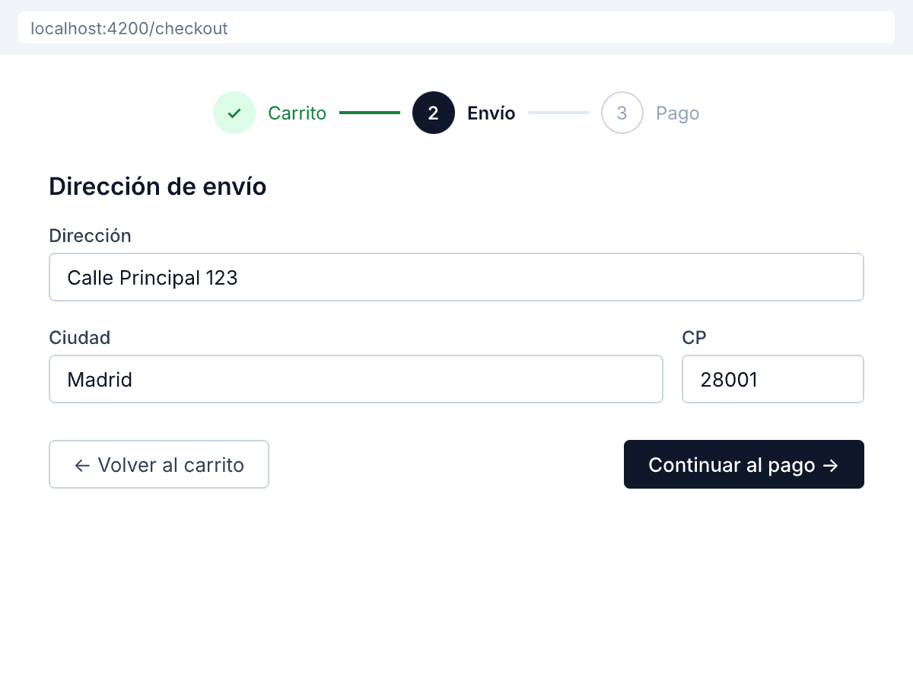

# 🟢 Actividad 3.5 — Construir un wizard multi-paso con validación por paso

[Inicio](../../README.md) > [Etapa 3](../README.md) > Actividad 3.5

- [ ] Completada

**Duración:** ~55 min

## Por qué esta actividad

Un formulario largo (checkout, registro, onboarding) es abrumador cuando se muestra todo a la vez. Un **wizard** lo divide en pasos pequeños y manejables. Pero hacerlo mal es peor que no hacerlo: si el usuario retrocede y sus datos desaparecen, si puede saltar al paso de pago sin llenar su dirección, o si el indicador de progreso miente, la confianza se destruye. Este patrón es tan común en aplicaciones reales que necesitas dominarlo.

| | |
|---|---|
| **Requiere** | Actividad 3.3 completada (sabes manejar formularios con Reactive Forms y validación Zod) |
| **Aprenderás** | Diseñar un flujo multi-paso con componentes separados por paso, preservar datos entre pasos usando un servicio, validar cada paso antes de avanzar, mostrar progreso al usuario, prevenir saltos de paso |
| **Al completar** | Tienes un flujo de checkout de 4 pasos (carrito, envío, pago, confirmación) donde los datos se preservan al retroceder, cada paso se valida antes de avanzar, y el progreso es visible |

**Lectura:**
- [Form State](../lecturas/03-form-state.md) (sección wizards, ~10 min)

## Antes de empezar

Necesitas tener completada la **Actividad 3.3** — sabes crear formularios con Reactive Forms y validar con Zod.

Un **wizard** (también llamado "stepper" o "flujo multi-paso") es un patrón de UI donde un proceso largo se divide en pasos secuenciales. Cada paso tiene su propia validación y el usuario puede avanzar y retroceder. El reto técnico es: ¿dónde guardas los datos de los pasos anteriores mientras el usuario está en un paso posterior?

La respuesta es: en un **servicio**. Cada paso es un componente que lee y escribe datos en un servicio compartido. El servicio persiste los datos entre pasos porque Angular lo mantiene vivo mientras la app esté abierta.

## Práctica paso a paso

> **Pasos:** [1. Crear el servicio de wizard](#paso-1--crear-el-servicio-de-wizard) · [2. Crear el componente principal](#paso-2--crear-el-componente-contenedor) · [3. Paso 1: Carrito](#paso-3--paso-1--carrito) · [4. Paso 2: Envío](#paso-4--paso-2--datos-de-envío) · [5. Paso 3: Pago](#paso-5--paso-3--datos-de-pago) · [6. Paso 4: Confirmación](#paso-6--paso-4--confirmación) · [7. Validar](#paso-7--validar-el-wizard)

### Paso 1 — Crear el servicio de wizard

1. En la terminal, ejecuta:
   ```bash
   ng generate service services/checkout
   ```
2. Abre `src/app/services/checkout.service.ts` y reemplaza su contenido:

```typescript
// src/app/services/checkout.service.ts
import { Injectable, signal, computed } from '@angular/core';

export interface CartItem {
  id: number;
  name: string;
  price: number;
  quantity: number;
}

export interface ShippingData {
  fullName: string;
  address: string;
  city: string;
  zipCode: string;
}

export interface PaymentData {
  cardNumber: string;
  expiry: string;
  cvv: string;
}

@Injectable({ providedIn: 'root' })
export class CheckoutService {
  // Paso actual
  currentStep = signal(1);
  readonly totalSteps = 4;

  // Datos de cada paso
  cartItems = signal<CartItem[]>([
    { id: 1, name: 'Camiseta Angular', price: 25, quantity: 2 },
    { id: 2, name: 'Sticker Pack', price: 5, quantity: 1 },
  ]);

  shippingData = signal<ShippingData | null>(null);
  paymentData = signal<PaymentData | null>(null);

  // Estado derivado
  cartTotal = computed(() =>
    this.cartItems().reduce(
      (sum, item) => sum + item.price * item.quantity, 0
    )
  );

  // Validación por paso
  isStepValid = computed(() => {
    const step = this.currentStep();
    switch (step) {
      case 1: return this.cartItems().length > 0;
      case 2: return this.shippingData() !== null;
      case 3: return this.paymentData() !== null;
      case 4: return true;
      default: return false;
    }
  });

  canGoToStep(target: number): boolean {
    // Solo puede ir al paso actual o anteriores
    // Para avanzar, el paso actual debe ser válido
    if (target > this.currentStep() + 1) return false;
    if (target > this.currentStep() && !this.isStepValid()) return false;
    if (target < 1 || target > this.totalSteps) return false;
    return true;
  }

  nextStep() {
    if (this.isStepValid() && this.currentStep() < this.totalSteps) {
      this.currentStep.update(s => s + 1);
    }
  }

  prevStep() {
    if (this.currentStep() > 1) {
      this.currentStep.update(s => s - 1);
    }
  }

  saveShipping(data: ShippingData) {
    this.shippingData.set(data);
  }

  savePayment(data: PaymentData) {
    this.paymentData.set(data);
  }

  reset() {
    this.currentStep.set(1);
    this.shippingData.set(null);
    this.paymentData.set(null);
  }
}
```

### Paso 2 — Crear el componente contenedor

1. Ejecuta:
   ```bash
   ng generate component checkout-wizard --standalone
   ```
2. Abre `src/app/checkout-wizard/checkout-wizard.component.ts`:

```typescript
// src/app/checkout-wizard/checkout-wizard.component.ts
import { Component, inject } from '@angular/core';
import { CheckoutService } from '../services/checkout.service';
import { CartStepComponent } from './steps/cart-step.component';
import { ShippingStepComponent } from './steps/shipping-step.component';
import { PaymentStepComponent } from './steps/payment-step.component';
import { ConfirmationStepComponent } from './steps/confirmation-step.component';

@Component({
  selector: 'app-checkout-wizard',
  standalone: true,
  imports: [
    CartStepComponent,
    ShippingStepComponent,
    PaymentStepComponent,
    ConfirmationStepComponent
  ],
  templateUrl: './checkout-wizard.component.html',
  styleUrl: './checkout-wizard.component.css'
})
export class CheckoutWizardComponent {
  checkout = inject(CheckoutService);
}
```

3. Abre `src/app/checkout-wizard/checkout-wizard.component.html`:

```text
<!-- HTML: src/app/checkout-wizard/checkout-wizard.component.html -->
<div class="wizard">
  <div class="progress-bar">
    <div class="step-indicator"
         [class.active]="checkout.currentStep() >= 1"
         [class.completed]="checkout.currentStep() > 1">
      1. Carrito
    </div>
    <div class="step-indicator"
         [class.active]="checkout.currentStep() >= 2"
         [class.completed]="checkout.currentStep() > 2">
      2. Envío
    </div>
    <div class="step-indicator"
         [class.active]="checkout.currentStep() >= 3"
         [class.completed]="checkout.currentStep() > 3">
      3. Pago
    </div>
    <div class="step-indicator"
         [class.active]="checkout.currentStep() >= 4">
      4. Confirmar
    </div>
  </div>

  <p class="step-count">Paso {{ checkout.currentStep() }} de {{ checkout.totalSteps }}</p>

  @switch (checkout.currentStep()) {
    @case (1) { <app-cart-step /> }
    @case (2) { <app-shipping-step /> }
    @case (3) { <app-payment-step /> }
    @case (4) { <app-confirmation-step /> }
  }
</div>
```

4. Agrega los estilos en `checkout-wizard.component.css`:

```css
/* src/app/checkout-wizard/checkout-wizard.component.css */
.wizard {
  max-width: 600px;
  margin: 0 auto;
}

.progress-bar {
  display: flex;
  justify-content: space-between;
  margin-bottom: 1.5rem;
}

.step-indicator {
  padding: 0.5rem 1rem;
  border-radius: 4px;
  background: #e0e0e0;
  font-size: 0.875rem;
}

.step-indicator.active {
  background: #1976d2;
  color: white;
}

.step-indicator.completed {
  background: #2e7d32;
  color: white;
}

.step-count {
  text-align: center;
  color: #666;
  font-size: 0.875rem;
  margin-bottom: 1rem;
}
```

### Paso 3 — Paso 1: Carrito

1. Crea la carpeta `src/app/checkout-wizard/steps/`
2. Crea `src/app/checkout-wizard/steps/cart-step.component.ts`:

```typescript
// src/app/checkout-wizard/steps/cart-step.component.ts
import { Component, inject } from '@angular/core';
import { CheckoutService } from '../../services/checkout.service';

@Component({
  selector: 'app-cart-step',
  standalone: true,
  template: `
    <h2>Tu carrito</h2>
    <ul class="cart-list">
      @for (item of checkout.cartItems(); track item.id) {
        <li>
          {{ item.name }} x{{ item.quantity }}
          — $ {{ item.price * item.quantity }}
        </li>
      }
    </ul>
    <p class="total"><strong>Total: $ {{ checkout.cartTotal() }}</strong></p>

    <div class="actions">
      <button (click)="checkout.nextStep()"
              [disabled]="!checkout.isStepValid()">
        Continuar al envío →
      </button>
    </div>
  `,
  styles: [`
    .cart-list { list-style: none; padding: 0; }
    .cart-list li { padding: 0.5rem 0; border-bottom: 1px solid #eee; }
    .total { font-size: 1.125rem; margin-top: 1rem; }
    .actions { margin-top: 1.5rem; display: flex; justify-content: flex-end; }
    button { padding: 0.5rem 1.5rem; cursor: pointer; }
  `]
})
export class CartStepComponent {
  checkout = inject(CheckoutService);
}
```

### Paso 4 — Paso 2: Datos de envío

1. Crea `src/app/checkout-wizard/steps/shipping-step.component.ts`:

```typescript
// src/app/checkout-wizard/steps/shipping-step.component.ts
import { Component, inject, OnInit } from '@angular/core';
import { ReactiveFormsModule, FormBuilder, Validators } from '@angular/forms';
import { CheckoutService } from '../../services/checkout.service';

@Component({
  selector: 'app-shipping-step',
  standalone: true,
  imports: [ReactiveFormsModule],
  template: `
    <h2>Datos de envío</h2>
    <form [formGroup]="form" (ngSubmit)="save()">
      <div class="field">
        <label for="fullName">Nombre completo</label>
        <input id="fullName" formControlName="fullName" />
      </div>
      <div class="field">
        <label for="address">Dirección</label>
        <input id="address" formControlName="address" />
      </div>
      <div class="field">
        <label for="city">Ciudad</label>
        <input id="city" formControlName="city" />
      </div>
      <div class="field">
        <label for="zipCode">Código postal</label>
        <input id="zipCode" formControlName="zipCode" />
      </div>

      <div class="actions">
        <button type="button" (click)="checkout.prevStep()">
          ← Volver al carrito
        </button>
        <button type="submit" [disabled]="form.invalid">
          Continuar al pago →
        </button>
      </div>
    </form>
  `,
  styles: [`
    form { display: flex; flex-direction: column; gap: 1rem; }
    .field { display: flex; flex-direction: column; gap: 0.25rem; }
    .field input { padding: 0.5rem; border: 1px solid #ccc; border-radius: 4px; }
    .actions { display: flex; justify-content: space-between; margin-top: 1rem; }
    button { padding: 0.5rem 1.5rem; cursor: pointer; }
  `]
})
export class ShippingStepComponent implements OnInit {
  private fb = inject(FormBuilder);
  checkout = inject(CheckoutService);

  form = this.fb.group({
    fullName: ['', Validators.required],
    address: ['', Validators.required],
    city: ['', Validators.required],
    zipCode: ['', Validators.required],
  });

  ngOnInit() {
    // Restaurar datos si el usuario vuelve a este paso
    const saved = this.checkout.shippingData();
    if (saved) {
      this.form.patchValue(saved);
    }
  }

  save() {
    if (this.form.valid) {
      this.checkout.saveShipping(this.form.getRawValue());
      this.checkout.nextStep();
    }
  }
}
```

> 💡 **Nota:** `patchValue()` en `ngOnInit` restaura los datos que el usuario ya llenó si retrocede a este paso. Esto es la "preservación de datos" que hace que un wizard sea usable.

### Paso 5 — Paso 3: Datos de pago

1. Crea `src/app/checkout-wizard/steps/payment-step.component.ts`:

```typescript
// src/app/checkout-wizard/steps/payment-step.component.ts
import { Component, inject, OnInit } from '@angular/core';
import { ReactiveFormsModule, FormBuilder, Validators } from '@angular/forms';
import { CheckoutService } from '../../services/checkout.service';

@Component({
  selector: 'app-payment-step',
  standalone: true,
  imports: [ReactiveFormsModule],
  template: `
    <h2>Datos de pago</h2>
    <form [formGroup]="form" (ngSubmit)="save()">
      <div class="field">
        <label for="cardNumber">Número de tarjeta</label>
        <input id="cardNumber" formControlName="cardNumber"
               placeholder="1234 5678 9012 3456" />
      </div>
      <div class="row">
        <div class="field">
          <label for="expiry">Vencimiento</label>
          <input id="expiry" formControlName="expiry"
                 placeholder="MM/AA" />
        </div>
        <div class="field">
          <label for="cvv">CVV</label>
          <input id="cvv" formControlName="cvv"
                 placeholder="123" />
        </div>
      </div>

      <p class="total">Total a pagar: <strong>$ {{ checkout.cartTotal() }}</strong></p>

      <div class="actions">
        <button type="button" (click)="checkout.prevStep()">
          ← Volver al envío
        </button>
        <button type="submit" [disabled]="form.invalid">
          Confirmar pedido →
        </button>
      </div>
    </form>
  `,
  styles: [`
    form { display: flex; flex-direction: column; gap: 1rem; }
    .field { display: flex; flex-direction: column; gap: 0.25rem; }
    .field input { padding: 0.5rem; border: 1px solid #ccc; border-radius: 4px; }
    .row { display: flex; gap: 1rem; }
    .row .field { flex: 1; }
    .total { font-size: 1.125rem; }
    .actions { display: flex; justify-content: space-between; margin-top: 1rem; }
    button { padding: 0.5rem 1.5rem; cursor: pointer; }
  `]
})
export class PaymentStepComponent implements OnInit {
  private fb = inject(FormBuilder);
  checkout = inject(CheckoutService);

  form = this.fb.group({
    cardNumber: ['', Validators.required],
    expiry: ['', Validators.required],
    cvv: ['', Validators.required],
  });

  ngOnInit() {
    const saved = this.checkout.paymentData();
    if (saved) {
      this.form.patchValue(saved);
    }
  }

  save() {
    if (this.form.valid) {
      this.checkout.savePayment(this.form.getRawValue());
      this.checkout.nextStep();
    }
  }
}
```

### Paso 6 — Paso 4: Confirmación

1. Crea `src/app/checkout-wizard/steps/confirmation-step.component.ts`:

```typescript
// src/app/checkout-wizard/steps/confirmation-step.component.ts
import { Component, inject } from '@angular/core';
import { CheckoutService } from '../../services/checkout.service';

@Component({
  selector: 'app-confirmation-step',
  standalone: true,
  template: `
    <h2>Resumen del pedido</h2>

    <section>
      <h3>Productos</h3>
      <ul>
        @for (item of checkout.cartItems(); track item.id) {
          <li>{{ item.name }} x{{ item.quantity }} — $ {{ item.price * item.quantity }}</li>
        }
      </ul>
      <p><strong>Total: $ {{ checkout.cartTotal() }}</strong></p>
    </section>

    <section>
      <h3>Envío</h3>
      @if (checkout.shippingData(); as shipping) {
        <p>{{ shipping.fullName }}</p>
        <p>{{ shipping.address }}, {{ shipping.city }} {{ shipping.zipCode }}</p>
      }
    </section>

    <section>
      <h3>Pago</h3>
      @if (checkout.paymentData(); as payment) {
        <p>Tarjeta: **** **** **** {{ payment.cardNumber.slice(-4) }}</p>
      }
    </section>

    <div class="actions">
      <button (click)="checkout.prevStep()">
        ← Volver al pago
      </button>
      <button class="confirm" (click)="confirm()">
        Confirmar y pagar
      </button>
    </div>
  `,
  styles: [`
    section { margin-bottom: 1.5rem; padding: 1rem; border: 1px solid #eee; border-radius: 4px; }
    section h3 { margin-top: 0; }
    ul { list-style: none; padding: 0; }
    .actions { display: flex; justify-content: space-between; margin-top: 1.5rem; }
    button { padding: 0.5rem 1.5rem; cursor: pointer; }
    .confirm { background: #2e7d32; color: white; border: none; border-radius: 4px; }
  `]
})
export class ConfirmationStepComponent {
  checkout = inject(CheckoutService);

  confirm() {
    alert('¡Pedido confirmado! (En una app real, esto enviaría los datos al servidor)');
    this.checkout.reset();
  }
}
```

### Paso 7 — Validar el wizard

1. **Progreso visible:** En cada paso, el indicador "Paso X de 4" y la barra de progreso deben reflejar el paso actual.
2. **Datos preservados:** Llena el formulario de envío, avanza al pago, retrocede al envío. Los datos que llenaste deben seguir ahí.
3. **No se puede saltar:** Intenta llamar `checkout.canGoToStep(3)` sin completar el paso 2. Debe retornar `false`.
4. **Validación por paso:** Intenta avanzar del paso 2 sin llenar todos los campos. El botón debe estar deshabilitado.

## Qué puede salir mal

- **"Los datos desaparecen cuando retrocedo"** → Verifica que el `ngOnInit` del componente de cada paso llama `patchValue()` para restaurar los datos del servicio. Si no lees los datos del servicio al volver, el formulario inicia vacío.
- **"Puedo avanzar sin llenar el formulario"** → Verifica que el botón tiene `[disabled]="form.invalid"`. Si `form.invalid` no funciona, verifica que los campos tienen `Validators.required`.
- **"El servicio se resetea al cambiar de paso"** → Verifica que `CheckoutService` tiene `providedIn: 'root'`. Si está provisto a nivel de componente, Angular lo destruye y recrea en cada navegación.
- **"No puedo compilar: módulo no encontrado"** → Verifica que creaste la carpeta `steps/` dentro de `checkout-wizard/` y que las rutas de import son correctas (con `../../services/`).

## Resultado esperado

Tu wizard muestra un flujo de checkout claro de 4 pasos. El usuario ve su progreso, puede retroceder sin perder datos, y no puede saltar pasos sin completar los anteriores.



**Criterios de aceptación:**
- [ ] El wizard muestra "Paso X de 4" y la barra de progreso se actualiza en cada paso
- [ ] Retroceder al paso anterior preserva todos los datos ingresados
- [ ] No se puede avanzar sin que el paso actual esté validado (botón deshabilitado)
- [ ] La confirmación muestra un resumen con los datos de todos los pasos anteriores

**Pilares de diseño ejercitados:**
- **Usabilidad** — El usuario sabe dónde está, puede retroceder sin miedo, y tiene un resumen antes de confirmar.
- **Mantenibilidad** — Cada paso es un componente independiente. El servicio centraliza los datos. Agregar un paso nuevo no rompe los existentes.

---

[← Actividad 3.4](./3.4-tipos-de-estado.md) | [Siguiente: Actividad 3.6 →](./3.6-state-machine.md)
