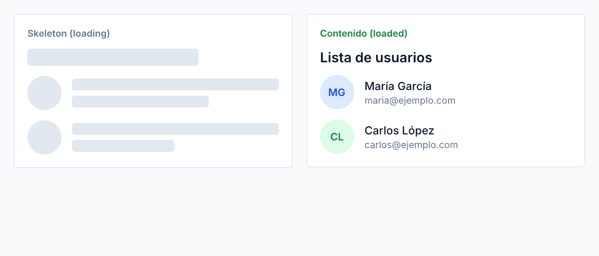

# 🟡 Actividad 4.6 — Implementar skeleton screens que coincidan con el layout

[Inicio](../../README.md) > [Etapa 4](../README.md) > Actividad 4.6

- [ ] Completada

**Duracion:** ~50 min

## Por que esta actividad

Cuando una aplicación tarda 2 segundos en cargar datos, el usuario puede ver tres cosas: nada (pantalla en blanco), un spinner girando, o un **skeleton screen** — una versión simplificada del layout final con formas grises pulsantes donde ira el contenido real.

Un spinner dice "estoy cargando" pero no dice que va a aparecer. Un skeleton screen dice "va a aparecer una tarjeta con un titulo, un número y un texto pequeno" — reduce la ansiedad y hace que la espera **se sienta** mas corta. Facebook, YouTube y LinkedIn usan skeleton screens por esta razón.

Pero un skeleton mal hecho (rectangulos genericos que no coinciden con el layout real) no aporta nada. La clave es que las formas del skeleton coincidan con el contenido que van a reemplazar. Y hay una excepcion importante: el elemento **LCP** (Largest Contentful Paint — la imagen o bloque de texto mas grande de la pantalla) no debe tener skeleton porque eso retrasa la metrica de rendimiento.

| | |
|---|---|
| **Requiere** | Actividad 4.4 completada (dashboard responsivo). Concepto de los 4 estados de data fetching (Etapa 3) |
| **Aprenderas** | Disenar skeleton screens que reflejen la forma del contenido real, implementar animación de pulse/shimmer con CSS, decidir que elementos llevan skeleton y cuales no (LCP) |
| **Al completar** | Tu dashboard muestra skeleton screens durante la carga que coinciden con la forma de las tarjetas de metricas. El skeleton tiene animación de pulse. El titulo principal (LCP) no tiene skeleton |

**Lectura:**
- [Data Fetching: 4 Estados](../../stage-3-state-and-data/lecturas/01-data-fetching-4-estados.md) (sección skeletons, ~10 min)

## Antes de empezar

Necesitas haber completado la **Actividad 4.4** (dashboard responsivo). Vas a agregar skeletons a ese dashboard.

Conceptos clave:

- **Skeleton screen**: una representacion estatica y simplificada del layout que se muestra mientras los datos cargan. Usa formas grises en lugar de texto e imagenes reales. No es un placeholder con texto "Cargando..." — es la **silueta** del contenido.
- **Animación pulse/shimmer**: una animación sutil que indica que el skeleton esta esperando datos. El pulse hace que el gris oscile. El shimmer mueve un gradiente de izquierda a derecha simulando un brillo. Ambos comunican "esto esta vivo, no esta roto".
- **LCP (Largest Contentful Paint)**: la metrica de rendimiento que mide cuanto tarda el bloque de contenido mas grande en renderizarse. Si pones un skeleton encima del LCP, el navegador cuenta el skeleton como el LCP y luego vuelve a medir cuando aparece el contenido real — empeorando la metrica.

## Practica paso a paso

> **Pasos:** [1. Identificar formas](#paso-1--identificar-las-formas) · [2. HTML del skeleton](#paso-2--crear-el-html-del-skeleton) · [3. CSS del skeleton](#paso-3--estilos-del-skeleton) · [4. Animación pulse](#paso-4--animación-pulse) · [5. Simular carga](#paso-5--simular-la-carga) · [6. Excluir el LCP](#paso-6--excluir-el-lcp)

### Paso 1 — Identificar las formas

1. Abre tu dashboard de la Actividad 4.4 en el navegador
2. Para cada tarjeta de metricas, observa la estructura:
   - Linea 1: titulo corto (texto pequeno) → rectangulo estrecho
   - Linea 2: número grande (metrica) → rectangulo mas ancho y alto
   - Linea 3: texto pequeno (caption) → rectangulo estrecho
3. Los skeletons deben replicar estas 3 formas
4. El titulo del dashboard ("Dashboard") es probablemente el LCP — este **no** llevara skeleton

### Paso 2 — Crear el HTML del skeleton

1. En el `index.html` de tu ejercicio 4.4, agrega versiones skeleton de las tarjetas. Puedes ponerlas dentro de la misma sección `.metrics` y alternar con JavaScript:

```text
<!-- HTML: agregar dentro de .metrics, antes o en lugar de las tarjetas reales -->
<div class="card skeleton-card" aria-hidden="true">
  <div class="skeleton skeleton--text-sm"></div>
  <div class="skeleton skeleton--text-xl"></div>
  <div class="skeleton skeleton--text-sm skeleton--short"></div>
</div>
<div class="card skeleton-card" aria-hidden="true">
  <div class="skeleton skeleton--text-sm"></div>
  <div class="skeleton skeleton--text-xl"></div>
  <div class="skeleton skeleton--text-sm skeleton--short"></div>
</div>
<div class="card skeleton-card" aria-hidden="true">
  <div class="skeleton skeleton--text-sm"></div>
  <div class="skeleton skeleton--text-xl"></div>
  <div class="skeleton skeleton--text-sm skeleton--short"></div>
</div>
<div class="card skeleton-card" aria-hidden="true">
  <div class="skeleton skeleton--text-sm"></div>
  <div class="skeleton skeleton--text-xl"></div>
  <div class="skeleton skeleton--text-sm skeleton--short"></div>
</div>
```

> 💡 **Nota:** `aria-hidden="true"` oculta el skeleton de los lectores de pantalla. Los usuarios con discapacidad visual no necesitan "ver" los skeletons — solo necesitan saber que los datos estan cargando, lo cual se comunica con un `aria-live` region o un status message.

### Paso 3 — Estilos del skeleton

1. Agrega estos estilos al `styles.css` de tu dashboard:

```css
/* ========== Skeleton screens ========== */
.skeleton {
  background-color: var(--color-neutral-200);
  border-radius: 0.25rem;
  animation: pulse 1.5s ease-in-out infinite;
}

.skeleton--text-sm {
  height: 0.875rem;
  width: 60%;
}

.skeleton--text-xl {
  height: 1.75rem;
  width: 40%;
}

.skeleton--short {
  width: 45%;
}

.skeleton-card {
  display: flex;
  flex-direction: column;
  gap: var(--space-3);
}
```

Observa que los tamanos del skeleton coinciden con los tamanos del contenido real:
- `skeleton--text-sm` tiene la misma altura que `--font-size-sm`
- `skeleton--text-xl` tiene la misma altura que `--font-size-xl`
- Los anchos son aproximados al ancho típico del texto que reemplazaran

### Paso 4 — Animación pulse

```css
@keyframes pulse {
  0%, 100% {
    opacity: 1;
  }
  50% {
    opacity: 0.4;
  }
}
```

Si prefieres un efecto **shimmer** (mas sofisticado):

```css
@keyframes shimmer {
  0% {
    background-position: -200% 0;
  }
  100% {
    background-position: 200% 0;
  }
}

.skeleton--shimmer {
  background: linear-gradient(
    90deg,
    var(--color-neutral-200) 25%,
    var(--color-neutral-100) 50%,
    var(--color-neutral-200) 75%
  );
  background-size: 200% 100%;
  animation: shimmer 1.5s ease-in-out infinite;
}
```

> 💡 **Nota:** Usa pulse o shimmer, no ambos. El pulse es mas simple y suficiente. El shimmer se ve mas refinado pero usa mas GPU.

### Paso 5 — Simular la carga

1. Crea o edita `dashboard.js` para simular una carga de 2 segundos:

```javascript
// dashboard.js — Simular carga para ver los skeletons
function simulateLoad() {
  const skeletons = document.querySelectorAll('.skeleton-card');
  const realCards = document.querySelectorAll('.card:not(.skeleton-card)');

  // Ocultar tarjetas reales, mostrar skeletons
  realCards.forEach((card) => { card.hidden = true; });
  skeletons.forEach((skeleton) => { skeleton.hidden = false; });

  // Simular carga de 2 segundos
  setTimeout(() => {
    skeletons.forEach((skeleton) => { skeleton.hidden = true; });
    realCards.forEach((card) => { card.hidden = false; });
  }, 2000);
}

// Ejecutar al cargar la pagina
simulateLoad();
```

2. Agrega `<script src="dashboard.js"></script>` en tu HTML antes de `</body>`
3. Recarga la página — deberias ver los skeletons por 2 segundos y luego las tarjetas reales

### Paso 6 — Excluir el LCP

1. Identifica tu LCP: generalmente es el titulo `<h1>Dashboard</h1>` o la tarjeta de metricas mas grande
2. Para verificar, en DevTools → Performance → grava una carga y busca "LCP" en el resumen
3. El LCP **no** debe tener skeleton — debe renderizarse directamente:

```css
/* El titulo del dashboard NO tiene skeleton */
.topbar h1 {
  /* Se renderiza inmediatamente — sin skeleton */
}
```

Si el LCP es una de las tarjetas de metricas (por ejemplo, porque tiene texto grande), considera renderizar esa tarjeta con datos del cache o con valores por defecto mientras cargan los datos frescos — en lugar de mostrar un skeleton.

## Que puede salir mal

- **"Los skeletons se ven como rectangulos solidos sin animación"** → Verifica que la regla `@keyframes pulse` esta en tu CSS y que la clase `.skeleton` tiene `animation: pulse 1.5s ease-in-out infinite`. Si usaste `animation-name` sin `animation-duration`, la animación tiene duracion 0 y no se ve.
- **"Los skeletons no coinciden con el tamaño de las tarjetas reales"** → Compara el `height` y `width` del skeleton con el tamaño real del texto que reemplaza. Abre DevTools, mide el `<h3>` de una tarjeta real (su height) y ajusta `skeleton--text-sm` para que coincida.
- **"Los skeletons parpadean un instante y desaparecen"** → Aumenta el `setTimeout` a 3000 o 4000ms para tener mas tiempo de observar. En produccion, los skeletons se ocultan cuando los datos llegan, no despues de un tiempo fijo.

## Resultado esperado

Al recargar la página, ves 4 tarjetas skeleton con formas que coinciden con las tarjetas reales (un rectangulo estrecho para el titulo, uno ancho para la metrica, uno estrecho para el caption). Las formas pulsan suavemente. Despues de 2 segundos, los skeletons se reemplazan por las tarjetas con datos reales. El titulo "Dashboard" se muestra inmediatamente — sin skeleton.



**Criterios de aceptacion:**
- [ ] Los skeletons reflejan la forma del contenido real — 3 bloques por tarjeta que coinciden en proporción con titulo, metrica y caption
- [ ] Animación de pulse o shimmer funcional — visible en los skeletons
- [ ] El elemento LCP (titulo del dashboard) no tiene skeleton — se renderiza inmediatamente

---

[← Actividad anterior](./4.5-fitts-hick-gestalt.md) | [Siguiente: 4.7 →](./4.7-dark-patterns.md)
